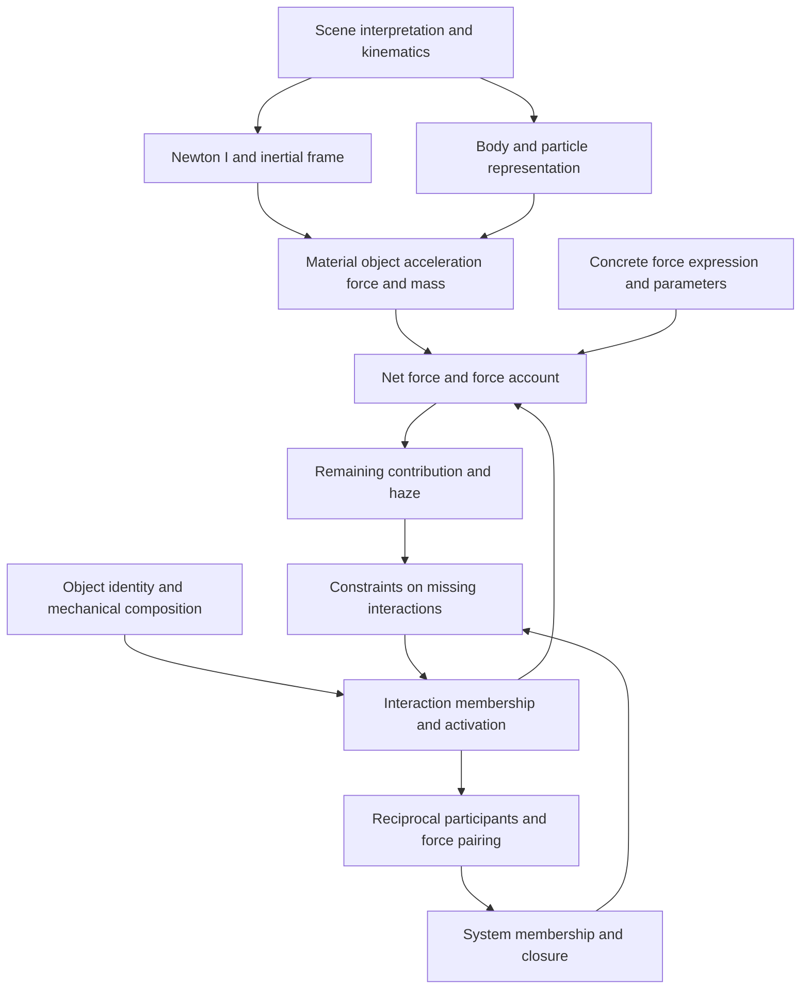

# How the Newton entries are intended to work

## An integrated account of the design and its unfinished connections

8 November 2026. Working synthesis for Newton entry production, requested by Can. This is an entry-facing interpretation of the sources and the explanations in this conversation. It is not an adopted replacement entry ledger, an entry packet, or a VD-docs record.

The intended Newton dictionary should carry a mechanics question through a connected account of objects, motion, interactions, force contributions, and system boundaries. A contribution is not merely a number to add. Admitting it commits the account to an activated interaction, a particular identity, a force quantity whose expression may still be unknown, and reciprocal consequences elsewhere. Conversely, an observed or inferred total can constrain what remains unaccounted for, without by itself identifying the missing object. The entries must make both directions available while preserving the distinctions that prevent a plausible calculation from becoming an invented explanation.

Much of this design is understood more clearly than the written entries suggest. The kinematic and Newton I–II route has actual entry text. The force-accounting architecture has substantial conceptual development, several corrected mistakes, and limited expansion experiments. The object, interaction, orientation, closure, and discovery connections remain distributed across proposals. The principal problem is how to connect these parts without losing identity, silently adding premises, or asking an aggregate equation to do a member-level job.

This synthesis treats declarative pseudocode as a useful intermediate language. A relation can specify what must hold before there is a finished implementation for finding its solutions. A finite collection can be traversed schematically without designing a complete list library. An object can have a declared identity and required relationships before a final object runtime exists. The freedom is to leave implementation details abstract; it is not to leave the consequences of those abstractions unspecified.

### Reading map

- [1. How to read the status of a claim](#1-how-to-read-the-status-of-a-claim)
- [2. The commitments supplied in this conversation](#2-the-commitments-supplied-in-this-conversation)
- [3. What an entry is doing](#3-what-an-entry-is-doing)
- [4. The house architecture and the dependency structure](#4-the-house-architecture-and-the-dependency-structure)
- [5. What exists on the local entry surface](#5-what-exists-on-the-local-entry-surface)
- [6. From a scene to a material target](#6-from-a-scene-to-a-material-target)
- [7. Newton I and Newton II](#7-newton-i-and-newton-ii)
- [8. Interaction membership and force aggregation](#8-interaction-membership-and-force-aggregation)
- [9. Acting objects and the two locks](#9-acting-objects-and-the-two-locks)
- [10. Pairing, convention, and system closure](#10-pairing-convention-and-system-closure)
- [11. Haze, uncertainty, and four kinds of completion](#11-haze-uncertainty-and-four-kinds-of-completion)
- [12. A declarative contract for reasoning before implementation](#12-a-declarative-contract-for-reasoning-before-implementation)
- [13. Worked consequence traces](#13-worked-consequence-traces)
- [14. Consequence traces and hypothesis sets](#14-consequence-traces-and-hypothesis-sets)
- [15. Where the entry design stands](#15-where-the-entry-design-stands)
- [16. How to use this synthesis for better traces](#16-how-to-use-this-synthesis-for-better-traces)
- [Provenance and coverage](#appendix-a-provenance-selection-and-coverage)
- [Source registry](#appendix-b-source-registry)

## 1. How to read the status of a claim

Five statuses recur below:

| Status | Meaning here |
|---|---|
| Current steering | An explicit user decision, including the explanations of 8 November, or a source whose relevant decision is recorded as adopted. |
| Existing entry text | Wording actually present on the active local entry surface. This does not certify that the wording implements every intention. |
| Developed proposal | A source develops the idea, sometimes in detail, but its adoption or integration remains open. |
| Synthesis deduction | A connection or consequence drawn in this document. Its premises are given so it can be assessed. |
| Open | A choice, missing relation, source conflict, or implementation question that this synthesis does not settle. |

Conceptual maturity and implementation maturity are different axes. A well-understood requirement can lack an entry. A runnable example can depend on supplied membership or a force formula and therefore leave the central conceptual problem untouched.

Managed sources are pinned to **VD-docs `dcbbe698abf1c0fe2e38cac1958aa9b4fefe3262`**, resolved from `main` for this work. The local production surface was inspected at **VD-Newton `61afb9ecf6f17a89ca6425e7e7642d6761531b05`**, together with the working files present on 8 November. The source appendix distinguishes managed context, historical material, local active work, and held/unsubmitted material. Dates alone do not establish precedence: an explicit correction, a source's stated scope, and the catalog's current/fate information matter.

The new explanations in this conversation are current steering on the intended behavior. They do not retrospectively make old entry strings implement that behavior. Earlier assistant interpretations in the conversation are interpretations, particularly around spring ownership and closure; they are not additional user rulings.

## 2. The commitments supplied in this conversation

### 2.1 The acting object's three properties

An acting object has three principal properties: **acting force, activation condition, and acting ID/name**. Whether these belong in one law is now explicitly uncertain. The required connection matters more than preserving an earlier proposed packaging.

Two commitments are firm:

1. If the acting force occurs as a contribution in the sum leading to net force, the object's activation conditions have been met. Inclusion carries that commitment; activation is not an independent optional label that can be detached from the included force.
2. The acting force is the quantity occupying that individual contribution. After haze and all the other contributions have been removed from the total, the remaining value and uncertainty constrain that same acting force. A disagreement with the acting-force expression is a failure of the specific Newton account being asserted.

The ID connects the recognition/activation side to the force-expression side. A trace must not change which object or interaction it is talking about while moving between them.

Activation content may be a long document. Its job is to teach a person when the conditions hold, with the qualifications and exceptions needed for correct recognition. Recognizing a flower is the guiding analogy: an open-ended task whose instructions are judged by how reliably they elicit the correct recognition. A short Boolean label can record the result, but it does not replace the instructional content.

### 2.2 Every action force carries a missing-pair problem

The counterpart problem is present for every action force. An account may already identify the counterpart, or it may leave the counterpart unresolved. Its recipient may lie inside or outside the chosen system. The force must also have the right object association: a spring interaction makes a commitment concerning a spring, potentially represented through a particle's mechanical composition.

The user explicitly marked that last route as not yet exact. The transition from a named force to a component, from a component to its particle representation, and from that representation to system membership needs articulation. It is not supplied merely by writing an opposite vector.

### 2.3 Both locations must remain possible until constrained

For an unpaired force in the current account, the theory must allow the internal-counterpart and external-counterpart alternatives. The logical form is a disjunction or a pair of conditional branches, not a simultaneous assertion that the same counterpart is in both locations.

If enough additional information identifies the relevant spring/source participant and establishes that the reaction recipient is inside the system, the intended entries should force the internal counterpart. The user left the physical and representational sufficiency of “belongs to this spring” open. This document therefore separates the sound conditional inference for identified participants from the unfinished VD representation of that identification.

### 2.4 The working method

Lists, sets, loops, and objects should first be understood declaratively. They can remain abstract when their consequences are bounded well enough to support honest traces. Implementing a structure is useful when it resolves a question; implementation is not a prerequisite for discussing every consequence.

## 3. What an entry is doing

### 3.1 Fixed strings and effects on readers

The original Punnet/Pundit Square separates the definition of definition, definition of meaning, meaning of definition, and meaning of meaning. For this work, its practical consequence is that a named dictionary supplies fixed definition strings, while encounters with those strings have causal effects on interpreters. A force-entry string and the procedure it elicits are related but are not the same object. A formula's apparent familiarity is not evidence that the intended procedure has been specified.

The later handle account supplies the operational vocabulary: a stimulant affects a target; a local handle routes it; probes produce a dossier; discipline stabilizes the behavior within a stated grain and probability budget. Entry wording succeeds when it reliably leads the intended reader or model through the right operation. This is why the long activation document is central rather than ornamental. Its recognition work is part of the theory's usable apparatus. [F1], [F2]

This also limits what a structural audit can certify. Detecting the required headwords does not establish that the residual prose causes correct recognition, arithmetic, classification, or inference. Those are further claims about disciplined interpretation.

### 3.2 The answer and the trace arise together

The working route is:

```text
question and stated context
  -> chosen headword with explicit arguments
  -> selected entry
  -> exposed daughter demands and residual wording
  -> supplied inputs and meaningful operations
  -> answer, constraint, conditional answer, or informative halt
```

The trace is the route that produces the answer. It is not a later narrative reconstructed from a textbook solution. An explanation can subsequently prune and smooth that route into a because-trace, but it cannot add a physical premise that the route never supplied. [F3], [L1]

Normalization is substantive. “Acceleration” can mean a trajectory derivative in a specified frame or the material-object quantity linked to Newton II. “Force” can mean a particular contribution or the resultant. Replacing “B's gravitational force on A” with “A's net force” changes the question and loses B. A successful answer to the replacement question is not a successful trace of the original one.

### 3.3 Residues have positions and permitted inputs

At entry $E_n$, write the intended operation as $\operatorname{Res}_n(B,C)$. The index matters: there is no universal free-floating residue capable of importing whatever the solver needs. Distinguish the residual string left after headword recognition, the handle it presents, the reader's actual response, and the ideal operation being modeled. [F2], [F4]

The no-lookup discipline permits local wording, explicitly delivered arguments, and external competence. It does not permit an interpreter to retrieve convenient facts from an earlier trace position without exposing that dependence. “Context” below abbreviates a stated scope, not a hidden global database. When a computation needs mass, a force binding, an endpoint identity, or a convention, that input must be delivered at the relevant site. [C1]

A named competence can remain external: differentiation, numerical estimation, recognition, or solving an explicitly supplied constraint system need not all be implemented inside the dictionary. The trace still needs to show the inputs, the operation invoked, and the returned result. An external capability is not permission to invent new mechanics.

### 3.4 Witness sheets are outside the trace

The October witness-sheet clarification corrects several local Design 3 guides. A witness sheet is testimony about a scene, potentially ordinary prose. The person answering a wall may consult it. The trace does not directly read a sheet schema, and the sheet itself does not force the theory's consequences. [F5]

Three different objects therefore need separate treatment:

| Object | Role |
|---|---|
| Witness testimony | Describes the scene outside the trace; may be incomplete, mistaken, or a stipulated example. |
| Explicit trace bindings | Record the information supplied at a demanded site, with object and context preserved. |
| Entry-defined kind or object relations | Specify what follows from accepting a kind, attribute, or interaction claim. |

Older “open the sheet and read the slot” diagrams remain useful as an account of the human's peripheral work. They are not the current mechanism-side specification. Likewise, a force-account accumulator is trace-side state represented explicitly; calling it a witness sheet would reproduce the documented terminology collision.

Reachability and kind membership are also different. A force demand may expose mass and acceleration through the entries. A commitment that an object belongs to a kind may require other attributes even when the current numerical query never requests them. The latter is the intended meta-object work and is not fully implemented. In either case, **an attribute's existence does not supply its numerical value**.

### 3.5 Relations, evaluation, and the Haskell analogy

The Haskell essay is helpful for immutability, explicit dependencies, and lazy demand. Its stronger claims should not govern the implementation: compilation does not prove physical consistency, a loop does not identify a physical law, and fixing one quantity in $F=ma$ does not in general determine the other two. With $a=2$, both $(m,F)=(1,2)$ and $(3,6)$ satisfy the equation. [F6]

The official Haskell semantics explicitly allows well-typed computations that fail or do not terminate. Lazy functional evaluation is a useful operational analogy, while a law can be better represented at this intermediate stage as a constraint relation whose solutions remain partially determined. [X1]

Constraint logic programming gives a second useful analogy: constraints can remain pending and combine information before concrete solutions are selected. That supports symbolic forces, unknown participants, and equations supplied in different orders. It does not make arbitrary physical recognition or complete logical search automatic. [X2]

For closure, ordinary negation-as-failure is especially unsuitable. Failure to prove that a partner is present does not establish that it is absent. A complete declared finite domain can justify an exhaustive check; an incomplete physical inventory cannot. [X3]

## 4. The house architecture and the dependency structure

### 4.1 The structural unit

A law triplet is represented by three jointly dependent corners:

$$
A\to(B,C),\qquad B\to(A,C),\qquad C\to(A,B).
$$

These are joint dependencies. A pairwise graph is a useful projection but loses the fact that one entry's residue composes both daughter demands. The six-entry house supplies outward grounding around the triplet: an earlier chimney for the old November headword, the three inward corners that introduce two winter headwords, and later walls for those winters. A wall can supply the prior grounding for another house. [F4]

The roles are not six independent equations. Nor do two definitions of one headword mean unrestricted choice between interchangeable wordings. They provide complementary inward and outward uses. Selecting the appropriate definition at a trace site remains an explicit execution issue, especially for queries whose purpose is measurement rather than prediction.

```text
earlier grounding of A                         chimney
        |
        +-- A through B and C
            B through A and C                  law triplet
            C through A and B
                   |        |
            grounding B   grounding C           walls
                   |
             possible anchor of a later law
```

### 4.2 What is secure and what is disputed

The admission argument explains why naming a new theoretical item needs a stated relationship to an already available candidate and a differentiator, rather than merely adding a word. Its local semantic argument is distinct from proving that every physical theory must have exactly the proposed global architecture. [F7]

There is a concrete source tension. Earlier guides prohibit a corner from containing the whole law. The October discussion records the user's clarification that a corner may carry the whole content. Therefore this synthesis preserves the requirement that the corners have intelligible roles and dependencies, but does not use “one corner contains the whole equation” as an automatic rejection test. The formal rule and older templates still need reconciliation. [F4], [F8]

The November minimality and house-count analysis provides useful deductions under stated premises. Its universal factorization, peripheral-constraint rules, unique-November restriction, and persistence slot are not all settled. In particular, the persistence of one mass or one source across multiple observations does real work that a single instantaneous house picture can omit. Here, persistence is made explicit in the relevant trace commitments; a final house placement is left open. [F9]

### 4.3 The intended Newton connections

The following is a map of conceptual dependence, not an assertion that these arrows are all implemented entry edges:



The visible cycle around discovery is not a command to mutate a dictionary. A provisional scenario can acquire additional explicit premises or branch into alternative completions while the dictionary edition remains fixed. Revising the theory itself is a different operation.

The existing lesson ordering is a guide, not a solution to these dependencies. NML3 force membership already needs some identity machinery that the older ledger places in later acting-object and meta-typing blocks. Options include introducing a minimal identity relation earlier, moving more object content, or using an explicitly bounded temporary object contract. The August forward map leaves that choice open. [L2]

### 4.4 Two important identity levels

A theory edition identifies which strings and rules authorize an inference. A scenario identifies which objects, interactions, times, and frames a particular inference concerns. Confusing either level creates false continuity.

At the theory level, an entry added in a later edition cannot be cited as though it existed in the earlier one. At the scenario level, an unknown body fitted at one time cannot be silently replaced by another body at the next time while claiming one persistent explanation. Reuse needs the same object identity and a justified validity interval.

## 5. What exists on the local entry surface

There are three main local layers. The v0.6 Python snapshot contains older operational entries and structural auditing machinery. The Design 3 ledger explores the fuller architecture. Design 2.1 is the active conservative drafting surface, retaining important Design 3 corrections while deferring full objects, concrete acting-object dispatch, and closure machinery. They should not be merged into a fictional completed version.

The active draft contains the kinematic scaffold and numbered entries through E11. Its kinematic terms distinguish path from trajectory, speed from velocity, an instant from an interval, and a derivative from a material-object force claim. E2–E6 give the Newton I house around uniform motion, free particle, and inertial frame. E7 bridges trajectory acceleration to the material-object quantity; E8–E10 express Newton II; E11 is the outward net-force entry. E11's present text ends after saying there are exactly two ways to obtain the vector. The intended routes are better developed in the working material than in that short installed wording. That counted pointer belongs to NML2.1's limited supplied/inferred-force treatment; it does not prohibit later force-sum production. [L3], [L12]

The ratified Force-Sum names are:

```text
net-force / impressed-force / interaction-set
```

The August decision settles the names and minimum typed relation. It does not settle final E13-and-later entries, all wall placements, membership, closure, or the action/reaction cut. In particular, the aggregate-versus-member bug is an active correction: an aggregate condition cannot in general, by itself, determine which individual interaction belongs in the collection. [L4]

“Current” in a README therefore means current working surface, not complete implementation. Conversely, “deferred” in Design 2.1 is a scope choice, not evidence that the project has no ideas about the deferred subject. The remainder of this synthesis reconstructs those ideas while keeping their status visible.

## 6. From a scene to a material target

### 6.1 A particle description has conditions of use

The entry user may supply “A is the material target” for an elementary calculation. A deeper question asks how that target was obtained from the scene. Those are different demands, and the latter has substantial analysis behind it.

The current scene-trackability account begins with proposed referents, an observational frame, an interval, a tracking procedure, and reliability qualifications. Its output is a covered family of usable tracks. It deliberately stops before particle count, lumping, force, or mass. Successful tracking and adequate scene coverage are separate: a perfectly tracked small sample may miss important motion. Removing failed tracks can also invalidate an earlier coverage assessment. [M6]

Operational re-identification across observed frames is distinct from a continuous, nonbranching trajectory model. Finite samples do not uniquely determine the interpolating trajectory. Neither does failure of one tracking description establish that no mechanical description of the material is possible. Older broad claims about fluids or quantum matter should be read through these later qualifications.

### 6.2 Bundling needs more than one tolerance

The older trackability d4 uses near-constant vector offsets to group tracks. This exposes translation, rotation, nontransitivity at finite tolerance, and overlapping admissible cliques. The July review corrections distinguish three tests more carefully:

| Test | Intended licence |
|---|---|
| Distance preservation within a shape tolerance | Treat the selected material as a body in the relevant sense. |
| Residual scatter within a translational tolerance | Use the selected representative for a translational particle description. |
| Localisation relative to the question | Neglect the representative's unresolved spatial extent where the question requires that. |

A rotating body can satisfy the first test and fail the second. An admissible body is therefore not automatically a complete one-particle description. The corrections are analysis and lesson development, not fully integrated object entries. [M7], [M8]

At finite tolerance, “close enough to move together” need not be transitive. Consequently a connected-component algorithm is not automatically the correct bundling procedure. Declarative pseudocode can instead state the admissibility constraints and retain several possible bundles. Choosing among overlapping admissible bundles remains an explicit modelling decision.

### 6.3 Address, value, and permission to reuse

The mass pipeline separates three jobs:

```text
identify/lump the material target -> a mass address for that target
determine mass                   -> information at that address
establish persistence/lineage     -> permission to use it later
```

An address can exist while its value is unknown. A value can remain written down after its licence for a later target has expired. A known total does not make every part mass known. [M9], [M10]

Reusing a mass after fragmentation, reassembly, occlusion, or exchange of material requires the corresponding continuity/accounting premises. Apparent return to the old shape does not prove that the same material returned. The distinction is consequential for missing objects: an interaction's identity must survive a system-boundary change, while a body's representation may need to change when the question or tolerance changes.

The glass-ball reconstruction shows how declarative reasoning can avoid unnecessary implementation. Suppose a known original mass equals the sum of unknown fragment masses, and the same fragments later form a new target. If coverage, material closure, fragment persistence, and the assembly/partition relations are licensed, the new total equals the old one without evaluating each fragment mass. The symbolic family does the work. If a fragment is missing, the missing term remains. [M12]

A positional tolerance cannot bound lost mass. The review proposes a separate mass-coverage allowance. Its exact form remains open, but the logical requirement is clear: if $M_A=M_B+m_{\rm loss}$ and $0\leq m_{\rm loss}\leq\varepsilon_m$, the loss is one-sided information, not an unexplained symmetric variance added to $M_B$. [M8]

### 6.4 Composition and centre of mass are later connections

Summing interactions on one target and combining already established target accounts are different operations. The latter can support additive mass under a representative-adequacy premise. General centre-of-mass dynamics requires the relevant force and interaction-pair conditions as well. Newton II alone does not provide every composition rule. [M10], [M11]

For shared translational acceleration, many affine-weighted representative points share that acceleration; the calculation alone does not uniquely select the centre of mass. Its broader role belongs to the wider dynamics. Projected fluid or chain examples likewise may provide a common speed without a common position, or leave configuration information needed by a future force calculation outside the representative. An object abstraction must declare which quantities it licenses, rather than silently filling every point-particle attribute. [M13]

## 7. Newton I and Newton II

### 7.1 The frame bridge

Newton I links free particles, uniform motion, and inertial frames. It does not supply a special fallback route for an empty force list. The rejected `ao0`/Nothing construction should not return through a list base case or an equilibrium spring. [M1]

For a material object in an inertial frame, an independently justified empty interaction account gives a zero resultant and ordinary Newton II gives zero acceleration. A nonempty balanced account also gives zero acceleration. Uniform motion does not establish freedom from interaction; the current E4 explicitly blocks that converse.

Time scope matters. Zero acceleration at an instant is not uniform motion throughout an interval. For a free photon example, the route through free-particle status and Newton I can establish uniform motion, and the kinematic derivative can then be zero. It does not enter the material-object mass corner. This is a domain distinction within the proposed Newton edition, not a universal empirical claim about light in all circumstances.

The photon-certification discussion identifies a useful dependency: a missing-force inference is conditional on the frame claim. Its stronger uniqueness/gravity conclusions remain project arguments, not deductions already implemented by the active entries. An apparent force residual can require checking the frame before searching for a new interacting object. [M14]

### 7.2 One relation with different directions and domains

For one qualified material target,

$$
\mathbf F_{\rm net}=m\mathbf a,\qquad m>0.
$$

| Supplied exact information | Consequence |
|---|---|
| Positive mass and acceleration vector | One resultant vector. |
| Positive mass and resultant vector | One acceleration vector. |
| Nonzero force and acceleration related by a positive scalar | One mass, after compatibility is checked. |
| Both vectors exactly zero | Mass remains underdetermined; an independently known mass is not erased. |
| Exactly one vector zero, or incompatible nonzero directions | The exact commitments cannot satisfy this relation. |
| Only one nonzero quantity supplied | Usually a relation between remaining unknowns, not a numerical answer. |

The mass direction is not unrestricted vector division. The current entry checks codirectionality before taking a magnitude ratio. The prediction and force-attribution directions also require the same object, frame, relevant time scope, and valid mass binding throughout the substitutions. The matched averaging-window condition for measured inputs is a later proposed refinement, discussed below. [L3], [M2]

### 7.3 The measurement channels cannot secretly certify one another

Force-side evidence and trajectory-side evidence must remain separately identifiable. Requiring force to be pre-reconciled with acceleration before it can enter E8 makes the acceleration calculation depend on its own answer. Requiring acceleration to be pre-reconciled with force similarly obstructs E9. The managed E10 d5 explicitly rejects a compulsory upstream reconciliation step. [M2]

Measured inputs select the empirical branch by provenance, not by whether the displayed vectors happen to align. Aligned measurements still carry uncertainty. Joint estimation can be conditioned on Newton II while retaining the original observations, discrepancy, uncertainty assumptions, and method. Its constrained output is not an independent confirmation of the relation used to construct it.

Separately identifiable evidence does not necessarily mean statistically independent error. A shared clock, calibration, or instrument can create covariance. That dependence must survive into the declared estimation operation.

### 7.4 E10's more developed design is ahead of its local string

The installed local E10 already says “If either is measured” and invokes estimation. Managed d5's advance is chiefly architectural: it places joint estimation permanently in external competence, analogous to differentiation, and rejects compulsory upstream reconciliation. It does not leave the estimator waiting to become E12 or another numbered law. This supplies an important precedent for the present pseudocode method: a meaningful operation can remain external if its inputs, purpose, output, and conditions are sufficiently explicit. [M2]

Later mass rulings add further distinctions:

- The estimator investigation assumes Newton II; it is not itself the verdict mechanism for rejecting that law.
- Exact zero/zero is non-identifying. Measured all-zero data with positive declared uncertainty are different: under the intended estimator contract with a proper starting law, null evidence preserves that law or other licensed evidence rather than making mass undefined.
- Misaligned measured readings remain evidence with reduced weight; a hard preliminary compatibility gate would discard information the current estimator work intends to retain.
- Readings share a mass premise but do not silently borrow one another's signal-size/direction distribution.
- The same averaging window for force and acceleration is an important proposed interface condition in the October development. [M3], [M4], [M5], [M18]

The current result interface is unfinished. August's packet describes one latent codirectional pair alongside mass. September's discussion observes that averaged latent vectors need not themselves be codirectional; October's development emphasizes a mass law, point output, uncertainty and misfit. The point-readout/null-evidence requirements are not all reconciled. A pseudocode trace should therefore invoke a declared estimation contract and preserve its stated result type, rather than pretending one final schema has been adopted.

## 8. Interaction membership and force aggregation

### 8.1 The minimum typed distinction

For a target $p$ in stated conditions $C$, the ratified relation is schematically

$$
\mathbf F_{\rm net}(p,C)
=\sum_{i\in I(p,C)}\mathbf f(i\to p,C).
$$

Here $I(p,C)$ is an identity-bearing interaction-set. Its members are interactions; $\mathbf f$ supplies a target-directed impressed force for each. A vector value is not an interaction identity. [L4], [S1], [S2]

The collection problem therefore has several distinct parts: define the candidate domain; say when an individual candidate qualifies; preserve identity/equality; construct or characterize the admitted set; establish the relevant completion claim; obtain member values; aggregate them. These can be interleaved lazily. Their responsibilities cannot be erased by calling the whole operation “sum the forces.”

### 8.2 Why aggregate equality cannot supply membership

The equality $F=G+(F-G)$ holds for any vector $G$. It does not establish a physical interaction contributing $G$. Likewise, matching the observed resultant does not establish that all interactions have been included: an omitted cancelling pair leaves the resultant unchanged.

Additional structure can make an inverse problem identifiable, but that structure must be stated. The aggregate/member correction is a prohibition on extracting individual physical membership from the aggregate equality alone, not a prohibition on all inverse reasoning. [L4], [S2]

An admitted interaction whose value is unknown stays in the account. With all other terms determined, the sum constrains its value. With two unknown values, it normally constrains their sum. With membership itself unresolved, the remainder describes unaccounted influence and does not yet belong to one named object.

### 8.3 Sets, lists, and indexed families

The physical account is set-like in its identity discipline: rediscovering the same interaction must not count it twice. The numerical image is not a set of vectors: two distinct interactions yielding the same vector must both contribute. Coordinate components are not extra interactions, and algebraic cancellation does not delete the underlying interactions. [O6], [S3], [S14]

A list can provide an evaluation order over the set. Its position is a traversal index, not a physical ID. A declarative indexed sum can express the same consequence without materializing the list. The required invariant is all-and-only coverage of the selected identities, each with the correct target and context.

```text
selectedInteractions(p,C) = { i in declaredDomain | member(i,p,C) }
forceAccount(p,C) = sum [ impressedForce(i,p,C)
                         for i in selectedInteractions(p,C) ]
```

This is specification notation. It does not promise that the domain is enumerable, the recognition predicate mechanically decidable, or the search complete.

For an infinite exact interaction family, the aggregate also needs a convergence contract; finite-list arithmetic does not establish one. The finite retained accounts below avoid that implementation question while keeping an explicit allowance for omitted influence.

### 8.4 Generation and summation are two jobs

The held September notes distinguish finding/warranting members from traversing supplied members to build a sum. A finite run of successful discovery establishes a subset. It does not establish that no further member exists. A no-more-items conclusion therefore needs its own scope and warrant. [S3], [S11]

A symbolic fold can be as simple as:

```text
emit([], A)       = A
emit(i :: xs, A)  = emit(xs, A + demand(impressedForce(i,p,C)))
```

The accumulator here is an expression containing pending demands. It need not be a numerical vector. For a finite acyclic supplied list, the decreasing tail explains termination. It says nothing about whether the physical inventory was complete.

The existing named-cell experiment already demonstrates a restricted version using ordinary expansion. Its supplied cells hold members and tails; a shared emitter produces the addition syntax. Empty, singleton, reordered and equal-valued-distinct-member examples were reported. This is useful evidence for expression construction, not an implementation of physical recognition or a closure proof. The separate residual-fold experiment requires more runtime support. [S4], [S5]

### 8.5 A remainder invariant provides a second orientation

Partition the retained identities into exposed prefix $P$ and unprocessed tail $T$, keeping haze separate:

$$
\mathbf F_{\rm net}=A(P)+R(T)+H,
\qquad A(P)=\sum_{i\in P}\mathbf f_i,
\qquad R(T)=\sum_{i\in T}\mathbf f_i.
$$

Exposing a fresh member gives

$$
R(\{i\}\mathbin{\dot\cup}T')=\mathbf f_i+R(T').
$$

The old remainder is replaced by the contribution and new remainder. Successive remainders are not additional forces to be added together. The represented total stays fixed. At the end, $R(\varnothing)=0$ closes the selected traversal; it does not erase $H$. [S6], [S10]

The September staged prototype expanded a prebound spring demand and a continuing remainder. Resolving a pending call's argument from `IS(i+1)` and then specializing that call remains a separate implementation question. The invariant is usable in pseudocode without claiming that all nested call machinery exists.

The remainder-triplet cut remains a proposal. The later suggestion to use “contributions” rather than capital-R “Remainder” does not change the current ratified Force-Sum names. This synthesis uses remainder descriptively and does not install a new headword trio.

## 9. Acting objects and the two locks

### 9.1 A bounded object description

The older architecture places acting mechanisms in a particle's mechanical composition. Its paired-particle relation points back to the owner/carrier. This ownership inversion is present in v0.6 text, but it is not by itself an algorithm for discovering an unknown external object. [O1], [O12], [O15]

Mechanical-composition and interaction-set are different inventories. The first describes mechanisms the particle owns or carries; one carrier can own several. The second describes interactions contributing to a target's force account, including interactions whose mechanisms are owned elsewhere. Equating them would hide incoming interactions and recreate the discovery problem in a different form.

The current three-property steering can be supported by an abstract description such as:

```text
acting-kind:
  activation/recognition content
  participant qualifications and relevant relations
  acting-force expression or force constraint
  required constructs and parameters
  model regime and convention

acting-instance:
  explicit acting ID
  kind reference
  owner/carrier, if this architecture requires one
  participant/interface bindings
  currently supplied parameter and construct bindings
```

These are semantic fields for this synthesis, not adopted entries or a required witness-sheet schema. An immutable record or a set of relations could carry them. Values may be unbound. Existence of a force quantity and knowledge of its expression are separate.

Slots, constructs and parameters do different work. An endpoint is a participant slot; equilibrium configuration is a construct with meaning that may need its own explanation; stiffness is a parameter whose type depends on the spring model. Their separation exposes what a concrete force expression actually demands. [O1], [O4], [O13]

Even “spring” hides several possible typed interfaces:

| Narrow model | Deformation and delivered response |
|---|---|
| Scalar load–deflection description | Scalar extension and scalar load. |
| Fixed-axis spring | Signed displacement and a vector along a supplied axis. |
| Central two-endpoint connector | Endpoint-distance change and a radial vector along their current separation. |
| Vector oscillator | Vector displacement and a linear-map response; scalar stiffness is a special case. |
| Continuum elastic body | Strain/stress fields plus the interface operation that produces a resultant or traction. |

This is why a force profile, a physical coil, and an effective spring model cannot simply share an unqualified recognition rule. The first complete entry trace can choose one narrow model; it need not solve all elasticity before expressing its obligations. [O13]

### 9.2 The activation lock is more than an insertion check

The April OOP discussion already distinguishes checking a condition before inserting a term from making membership entail that condition. The latter is the intended logical strength. A later query should be able to start at the admitted contribution and recover the activation commitment. [O2], [O5]

```text
admitted contribution of interaction i on target p
  -> activation conditions for i hold
     under i's declared participant and context bindings
```

The recognition content must have independent substance. “Active because included; included because active” explains neither how a person recognizes the situation nor why the theory is applicable. The long prose document provides that substance, with its reliability assessed on the intended readers and cases.

For a reaction contribution, preserve the originating interaction's activation bindings. The reaction recipient need not satisfy a condition originally written for the nonowner/action recipient. A spring carrier, for example, is not required to qualify as the object attached to that spring merely because it receives the reaction. This is a synthesis deduction about how the activation lock must survive role reversal.

### 9.3 The value lock connects two routes to one quantity

With one contribution left to determine,

$$
\mathbf f_i
=\mathbf F_{\rm net}-H-\sum_{j\ne i}\mathbf f_j.
$$

The same $\mathbf f_i$ is addressed by the target-specific member expression, after its recipient/sign convention and any explicitly chosen representation weight are applied. A reaction-side remainder is not automatically equal to a quoted action-side vector $K$. The ID and its interaction/target bindings preserve equality of subject across the two routes. “Definitionally locked” means these cannot quietly become two different forces when their values disagree.

The comparison can nevertheless fail empirically. Independently determined inputs to the resultant/remainder route and to the constitutive-expression route may impose incompatible constraints. The particular account then fails. If one route merely recomputes data manufactured by the other, agreement is not an independent check.

Uncertainty belongs to the same quantity, too. Combining two determinations need not make their reported distributions or interval widths identical. It requires a joint compatible account, with dependencies retained. Treating correlated determinations as independent would artificially strengthen the claimed lock.

### 9.4 Dispatch is a real connection, but need not be a large runtime

Recognizing `s1` as a spring does not automatically specify which string an abstract activation or force demand should expose. The dispatch note proposes an explicit concrete-kind mapping as a first test. That is a sufficient pseudocode contract: a supplied kind/instance relation routes the abstract property demand to the corresponding concrete content, with the actual arguments preserved. It does not require a new dispatch law simply because programming languages have virtual methods. [O4]

Producer and constraint mechanisms can share an attribution interface. One may yield a formula; another may yield an instance-addressed unknown plus constraints. Both can enter a symbolic sum. An unknown tension is not a missing interaction, and requiring every term to be numerical before admitting it would break coupled mechanics problems. [O1]

The inventory and newer primitive-force investigations broaden this pressure. Gravity, elastic mechanisms, contact, connectors, damping, fluid interfaces and electromagnetic extensions need different recognition and parameter content. “Tension,” “weight” and “centripetal force” are not automatically distinct mechanism kinds merely because they are familiar force names. The static-electric/current work particularly insists that numerical force equivalence and shared notation do not establish source identity or equality of different current quantities. Those extension arguments are not complete installed Newton clusters, and their detailed physics has not been independently validated for this synthesis. [O16], [O17], [O18], [O19], [O20]

### 9.5 Identity is richer than equal properties

The April identity discussion uses explicit supplied IDs and rejects invisible background ID generation. Two objects with equal properties remain distinct; the same object encountered twice is not two objects. [O3]

A further synthesis deduction concerns three bodies. Suppose A owns one mechanism $G_A$, which interacts with B and C. Both reactions land on A. A key consisting only of $(G_A,A,C_{\rm context})$ would merge them. The account therefore needs either a participant-encounter interaction ID, narrower per-pair acting instances, or an explicitly declared aggregation before membership. Two-body tests cannot decide among these possibilities. The temporary contract below requires distinct interaction addresses without choosing the final ontology.

## 10. Pairing, convention, and system closure

### 10.1 Distinguish the relationships hidden in “belongs to”

| Relationship | Question it answers |
|---|---|
| Mechanical ownership | Which particle's composition contains the acting mechanism? |
| Interaction participation | Which entities take part in this occurrence? |
| Force recipient | On which target does this particular contribution act? |
| System membership | Does that recipient/participant belong to the selected system? |
| Computational orientation | Which member is quoted by the expression, and which is obtained by reversal? |

These relationships can coincide in a simple example, but they are not interchangeable. Identifying a spring's force on A fixes more than recognizing a spring-shaped numerical dependence. Passing from a physical component to a carrier particle still requires the representation link discussed in §6. [O6], [O14]

For an identified binary Newtonian interaction, a force by S on A requires the reciprocal force by A on S. The recipient is different. Including S inside the system then places that counterpart internally; observing it separately is not needed for the conditional deduction. This is the ordinary third-law relationship. [X4]

There need not be a second spring in A. The spring mechanism belongs to the interaction description, and the opposite contribution can be a force exerted by the other participant on the spring/carrier. An implementation that infers “every reciprocal spring force requires another spring mechanism in its exerting participant” would add an unwarranted requirement.

### 10.2 The convention changes a representation, not the physical force

The current orientation account lets a binary interaction quote a vector $K$ on one designated participant $c$. The other participant receives $-K$; a nonparticipant receives neither. [O7]

```text
impressedForce(i,t) = K   when t is the quoted participant
                    -K   when t is the other participant
                    N/A  when t is not a participant
```

Changing both the quoted participant and the sign of $K$ leaves the target-side forces unchanged. Changing only the sign changes the physical account. Thus the force-expression, recipient and convention must travel together. Pair existence and inside/outside reasoning can proceed before the numerical value is known.

Participant symmetry does not remove this choice. The meshing d2 corrects that earlier suggestion. Its later Part IX proposes that member-designating headwords such as `action-force_spring` and `reaction-force_spring` can install the convention through dictionary authority. A trace may then cite the relevant entry rather than repeatedly request a separate convention input. The final naming and placement are still open. [O8]

### 10.3 Half-weighting belongs to one candidate representation

The participant-symmetric proposal first establishes a conditional connection: under its nonempty owner-blind product-relation assumptions, same-kind reciprocal admission forces the owner-qualified and target-qualified classes to coincide. That is a result about the stipulated interface; participant-dependent spring attachment does not satisfy those assumptions. It establishes admission/eligibility, not nonzero force in every state. The relation between zero-valued occurrence, absence, and any nondegeneracy condition remains a separate question. [O9]

The proposal then considers two owned instances, one for each participant. If both representations generate an action and reaction, a target receives two representations of the conventional interaction. Equal half-weighting can then restore the intended total. This additional representation choice must be distinguished from the qualification result.

This is conditional representational normalization, not a general statement that physical forces are half their usual value. The owner-blind assumptions do not cover every spring attachment or contact relation. Nor does same-kind reciprocal eligibility alone require instantiating a duplicated representation. A declarative unique-pair representation is another implementation possibility; it does not inherently require global mutable state.

The spring guide rejects the earlier half-spring shortcut. The older spring brief and incline trace still contain material that must be read historically. Their successful arithmetic is not evidence that the halving rule should be carried into current entries. [L5], [L6], [L10]

### 10.4 Missing counterpart means an unresolved location

Use one unknown participant $q$ belonging to the same interaction:

```text
known contribution on p, with p inside S
  -> counterpart exists on q
  -> q is inside S OR q is outside S
```

The two branches retain the same obligation. Neither branch is discharged by writing an arbitrary opposite number. The object relationship, participation, activation, and force constraints still apply.

If q is identified and proved inside, its counterpart must be admitted to q's appropriate account. If it was merely unlisted, the partial account can be extended. If a supposedly complete account explicitly excludes it, those premises conflict. If no internal recipient is possible under a justified exhaustive scope, the external branch follows. Search failure or a missing list row is not that exhaustive scope.

An existential placeholder is not an observed object ID. It allows a question to carry the assertion that some participant exists while leaving its identity or location unknown. If the system itself is described incompletely, “inside” is also a pending relation rather than a lookup result.

### 10.5 Mechanical closure is an incidence condition

For the binary-interaction architecture, the strong closure claim can be stated:

> Every relevant active interaction touching the system has all its participants inside it.

Its use requires the appropriate completeness/domain premise. An internal pair's contributions cancel in the total system force, but external forces can also cancel. Zero resultant is therefore not a proof of interaction closure. Nor does one internal pair establish closure of every other interaction. [O7], [O11]

Closure and solvability are different. A system with a prescribed external force can support a prediction while remaining interaction-open. A closed system with missing initial conditions or undetermined constraints may remain unsolved. Older suggestions of “solvable iff mechanically closed” need these qualifications rather than becoming an implicit entry rule.

## 11. Haze, uncertainty, and four kinds of completion

### 11.1 Four questions that share the word closure

| Claim | What has been established | What has not |
|---|---|---|
| Traversal exhausted | No cells remain in the selected enumeration. | Physical completeness. |
| Exact interaction membership complete | All relevant interactions in the declared domain are represented. | Known values or mechanical closure of the selected system. |
| Account adequate at tolerance | Retained terms plus a justified omitted-effect allowance meet the question's accuracy requirement. | Exact absence of omitted interactions. |
| Mechanical system closed | Relevant interactions do not cross its boundary. | Zero individual forces, solved dynamics, or completed empirical investigation. |

These four claims need different evidence. A single `closed = true` field would conceal which one has been supplied. [S3], [S7], [S8], [S9], [O7]

### 11.2 Retained uncertainty and omitted influence

The later haze account proposes

$$
\mathbf F_{\rm net}=\sum_i(\widehat{\mathbf f}_i+\mathbf u_i)+\mathbf s_\varepsilon.
$$

Each retained interaction has its own key and uncertainty $\mathbf u_i$. The haze $\mathbf s_\varepsilon$ is one aggregate allowance for influence left outside the explicit account. It is not another invented interaction with an acting ID, and it is not an adjustable term whose unrestricted value guarantees agreement. [S9]

A named neglected interaction remains named: it can have a nominal zero and a bound on its contribution. This differs from the unkeyed aggregate of unnamed omissions. Knowing every retained term accurately does not establish that the account is sufficient.

The questioner supplies the required accuracy. Evidence supplies an achieved uncertainty or bound. The first cannot be inferred just from the second. A force account adequate for a rough acceleration answer may be inadequate for a long-horizon position prediction. [S7]

### 11.3 Three zeros and one shared error requirement

Exact zero, zero expectation under an explicit probability model, and a quantity reported as zero at finite resolution are different statements. A small directed force need not be mean-zero. Repeating `+0` does not prove the unprocessed remainder has vanished; $R=0+R$ is compatible with any remainder.

For deterministic bounds, retained error bounded by $b$ and omitted aggregate bounded by $h$ give a conservative total force-error bound $b+h$. Several approximations cannot each spend the whole allowed output error independently. Their combined effect must meet the question's requirement. A probability model needs its own dependency assumptions; separate names do not establish independent errors.

Under the restricted conditions of fixed positive mass, identical initial conditions, and a prescribed force discrepancy bounded by $h$ over a duration $T$, the position-error contribution is bounded by $hT^2/(2m)$. State-dependent dynamics require a suitable sensitivity argument. The example shows why the requested observable and time horizon belong in the adequacy claim, not that one universal force threshold answers every question.

### 11.4 Discovery through the remainder

A residual can constrain candidate mechanisms, parameters and locations. It does not uniquely identify them merely by fitting a number. A proposed new object must also satisfy recognition/activation, participant relations, the force expression, and consistency across the relevant observations. The same persistent object must do the work across those observations. [S10], [O11]

Accounting for a genuine force need not monotonically shrink the residual norm. If $+1=+10-9$, exposing the true $+10$ contribution leaves $-9$, whose magnitude is larger. Consequently “reduces the remainder” cannot mean a greedy admission rule accepting only terms that make the current numerical residual smaller. The discovery proposal concerns a supported account that can ultimately satisfy the constraints.

An internal missing interaction, an external one, a mistaken retained value, a frame error, and an incorrect activation/model commitment can all affect a remainder. The trace's prior commitments determine which alternatives are still live. Haze gives a bounded place for unresolved influence; it does not choose the diagnosis.

## 12. A declarative contract for reasoning before implementation

### 12.1 What the pseudocode is allowed to assume

The following contract is a synthesis proposal. Its names are explanatory notation, not new adopted headwords. It permits hand traces without choosing a full list library, object runtime, solver, or replacement law cut.

```text
QualifiedQuantity:
  subject identity; quantity kind; frame; instant or interval;
  exact/measured/constrained status; value or expression;
  uncertainty and relevant dependencies; provenance

InteractionDescription:
  interaction address; acting ID/kind where known;
  participant bindings, possibly existential;
  activation commitment and its original bindings;
  target-specific member expressions, possibly unknown;
  quoted-side convention or entry that installs it

AccountDescription:
  target and scope;
  retained identity-bearing interactions;
  enumeration, if one is used;
  exact-completeness or approximation-adequacy claim;
  retained uncertainty and omitted aggregate allowance
```

An incomplete description is legitimate. Missing fields remain visible and prevent only the consequences that require them. “This interaction exists” need not wait for its numerical force; “the force is 4 N” need not establish which mechanism produced it; “this is inside S” needs a system-membership relation.

The complete scope need not be serialized into every printed line. But the bindings an operation actually uses must be available explicitly at its execution site. A short symbol for a scope does not authorize hidden lookup. Reusing a previously obtained result means delivering that result and its qualifications, not inviting the interpreter to remember an earlier paragraph.

### 12.2 Minimum contracts and their limits

| Operation or relation | Required consequence | Boundary to preserve |
|---|---|---|
| Recognize an acting kind/condition | Return a scoped recognition commitment with a basis. | Recognition is fallible; unfamiliar or ambiguous cases may remain unresolved. |
| Admit an interaction contribution | Preserve identity, target eligibility and the activation implication. | Admission does not require a known numerical force or identify a new object from a vector. |
| Dispatch an abstract property | Expose the appropriate concrete content with the same arguments. | No unrecorded switch of kind, model regime or participant. |
| Enumerate a selected set | Each selected identity appears exactly once. | End of list proves only traversal exhaustion. |
| Aggregate | Construct a symbolic expression or impose the indexed relation. | Unknown members remain terms; equal values do not merge identities. |
| Isolate one member | Constrain that member by the same net-force relation. | Other unknown members and haze remain in the result. |
| Reverse a binary interaction | Preserve interaction and participants while changing the target-side force. | Nonparticipants do not receive a negative vector; activation bindings are not swapped indiscriminately. |
| Classify system incidence | Determine internal/crossing status from participant membership. | Missing membership information yields an open branch. |
| Assert adequacy | Supply a bound or explicit probability claim sufficient for the requested observable. | Numerical agreement alone does not certify adequacy. |
| Reuse a binding | Preserve object identity, interval, regime and validity conditions. | Stored value alone does not grant a new target or later interval the same property. |
| Solve constraints | Return justified values, a solution family, or inconsistency. | Neither a loop nor an arbitrary chosen solution proves a unique physical answer. |

Some logical obligations can then be stated compactly:

```text
Admitted(i,p,C)
  => Participates(i,p,C)
     AND ActivationSatisfied(i, originalBindings(i), C)

Admitted(i,p,C) AND BinaryNewtonian(i,p,q,C)
  => CounterpartExists(i,q,C)

Admitted(i,p,C) AND InSystem(S,p)
  AND CounterpartExists(i,q,C) AND InSystem(S,q)
  => InternalCounterpart(i,q,S,C)

Admitted(i,p,C) AND InSystem(S,p)
  AND CounterpartExists(i,q,C) AND OutsideSystem(S,q)
  => CrossingInteraction(i,S,C)
```

These implications state obligations of the proposed reconstruction. They do not imply that the present simulator can perform arbitrary forward chaining, find every contradiction, create existential objects, or decide system membership. A manual trace may carry the consequences while marking the missing entry paths.

### 12.3 Conservative treatment of unknowns

At minimum, distinguish:

```text
known value
symbolic value / constrained family
known existence with unidentified participant
unknown whether the premise holds
explicitly absent or disproved under a stated scope
undefined quantity for the chosen domain
inconsistent commitments
missing implementation or external capability
```

These are not all one `null` value. An existential participant is not zero force. An unbound mass is not a massless particle. An unknown activation result is not an inactive object. A missing implementation is not a refutation of Newton. A contradiction on a hypothetical branch does not license moving its premises into the other branch.

Proof by cases is possible at this level. Local assumptions belong to their branches and must be discharged when the branches rejoin. A trace that stores every temporary assumption as a global input would turn a valid case split into an incoherent account.

### 12.4 What the current machinery already demonstrates

The local `02_engine` code principally implements entries, tokenization, dependency views and structural audits. The later parameterized simulator experiments are a different implementation surface. Their existence should not be inferred from the structural engine alone. [C2], [L11]

The September function-call model describes entry selection followed by simultaneous token-aware substitution of explicit actual arguments, producing further lazy demands. Its prototype has atomic actuals, one signature per stem, flat partial instantiation, and no general closures or nested expression arguments. Every underscore suffix is an argument in that model; older static underscore qualifiers need migration. [C2]

`R` records an observed response to residual text. It is not an intrinsic arithmetic evaluator or a certified equivalence. The inspected historical prototype's guard also constrains whether a replacement may contain recognized headwords; this is not a claim about the latest simulator. Consequently the expansion-only named-cell summation is different from a residual operation that emits new active calls. The latter needs an explicit runtime/policy extension. [S4], [S5], [S21], [C2]

The argument-layer and scratchpad documents contain useful proposals, but do not establish a complete object system, generic constraint solver, or permission for hidden trace memory. A faithful paper trace can exceed a prototype's syntax while remaining explicit about which semantic step is proposed and which has actually run. [C3], [C4]

Randomness requires a similar explicit boundary. A declared distribution can remain part of an immutable description. If a particular sample is required, the boundary returns and binds that sample once for its stated use; demanding the same bound attribute again must not silently resample it. Uncertainty about one fixed force is not automatically a succession of new forces. The randomness proposal's older direct witness-sheet language is subject to the later witness correction in §3.4. [F15]

## 13. Worked consequence traces

These examples are reconstructed logical traces. They are not new simulator runs. `ENTRY` denotes a route supported by the current entry text; `INPUT` identifies supplied scenario content; `CONTRACT` invokes a proposed semantic connection from this synthesis; `DERIVE` applies stated mathematics; `OPEN` names the remaining gap. An `ENTRY` annotation does not imply the simulator automatically discovers that route.

### Trace 1 — zero acceleration with two different object commitments

```text
Case A
INPUT: A is a material object in an inertial frame; a(A,t)=0.
ENTRY E9: Fnet(A,t)=m(A)*a(A,t).
ENTRY E10: m(A) is positive; exact zero/zero does not identify its value.
DERIVE: Fnet(A,t)=0, while a numerical mass can remain unknown.
OPEN: which individual interactions act on A.

Case B
INPUT: P is a free photon throughout an interval in an inertial frame.
ENTRY E6, E2, E1: P has uniform motion over that interval.
ENTRY K12: kinematic acceleration is zero at interior times.
No material-object mass inference is made.
```

The same acceleration value does not make the object commitments equivalent. In Case A, a mass is required by the accepted material-object account without being measured. In Case B, the stated route never demands it. Neither case licenses uniform motion from a zero at only one instant. [F10]

### Trace 2 — a known member with an unknown force value

```text
INPUT: fixed target p, frame and instant; admitted interactions i1,i2.
INPUT: this retained account is complete for the stated calculation; H=0.
INPUT: Fnet(p)=10 N in the chosen direction; f(i1,p)=6 N.
CONTRACT: Fnet(p)=f(i1,p)+f(i2,p).
DERIVE: f(i2,p)=4 N.
OPEN: i2's force law across other states, if not already supplied.
```

This is inverse determination of an admitted member, not physical discovery of i2 from arithmetic. If a second unresolved interaction j were also allowed, the conclusion would instead be $f(i2,p)+f(j,p)=4\,\mathrm N$. If an unbounded haze remained, even that numerical attribution would not be available.

### Trace 3 — the value lock exposes an incompatible account

Use deterministic scalar intervals for this illustration, with all quantities expressed in one direction:

```text
INPUT: independently determined net force in [9.9,10.1] N.
INPUT: sum of the other retained contributions in [5.9,6.1] N.
INPUT: justified omitted aggregate H in [-0.2,0.2] N.
INPUT: one remaining admitted interaction i_s with a fixed acting ID.
DERIVE: its remaining force is contained in [3.6,4.4] N.

INPUT/CONTRACT: its target-specific spring expression predicts [4.9,5.1] N
               from separately supplied parameters and deformation.
DERIVE: the feasible intervals do not meet.
RESULT: these commitments cannot all describe this Newton account.
```

The 0.5 N gap between the intervals makes the failure explicit. It does not uniquely identify the mistaken premise. Changing the spring ID, sign convention, haze allowance, or activation declaration would create a revised account whose changes must be visible. The contradiction cannot be removed while pretending the original commitments were unchanged.

### Trace 4 — an active equilibrium spring remains an interaction

```text
INPUT: spring s is recognized in the stated ideal regime and remains attached.
INPUT: its interaction i is admitted as a contribution on target p.
INPUT: its signed deformation is zero.
CONTRACT: its admitted interaction entails the applicable activation conditions.
CONTRACT: the target-specific expression evaluates to zero force here.
RESULT: the interaction remains in the account with value zero.
```

This blocks three wrong inferences: zero value does not mean no interaction, no spring, or a new `ao0` object. The model's zero state and its activation instructions must agree; an entry that defines activity by nonzero extension would implement a different condition.

### Trace 5 — an unresolved counterpart preserves both branches

```text
INPUT: p is inside S; interaction i supplies a contribution on p.
CONTRACT: i has a reciprocal contribution on some participant q.
OPEN: q's identity and system membership.

Branch I, conditional on q inside S:
  the counterpart belongs to q's internal account;
  an omitted internal contribution/participant can be sought.

Branch O, conditional on q outside S:
  i crosses the boundary;
  S is not strongly interaction-closed under this account.

RESULT: existence obligation plus location alternatives.
```

If a justified closure premise is also accepted, the external branch is incompatible with that premise and the counterpart must be internal. If justified internal exhaustiveness excludes every internal recipient, the external branch follows. Without either restriction, the partial trace cannot choose.

### Trace 6 — an identified internal spring forces the counterpart

```text
INPUT: i is the interaction of spring s with p.
INPUT: i's contribution on p is admitted in the account.
INPUT: q carries s under the declared particle/composition representation.
INPUT: p and q are inside S.
CONTRACT: i's force on p has its reciprocal contribution on q.
DERIVE: that counterpart is internal and belongs in q's relevant account.
```

No second observation of the reaction is needed for this conditional inference. The trace does need the spring/interaction attribution and the component-to-carrier link. If q's account is merely partial, extend it. If it is asserted complete and explicitly excludes this interaction, report incompatibility. The activation commitment is still the original spring interaction's condition with its original bindings.

### Trace 7 — convention reversal preserves the force and closure

```text
INPUT: interaction i has participants p,q.
Representation A: quote K=(4,-2) N on p; q receives (-4,2) N.
Representation B: quote K'=(-4,2) N on q; p receives (4,-2) N.
DERIVE: every participant receives the same vector in A and B.
INPUT: p inside S, q outside S.
DERIVE: i crosses S in both representations.
```

The trace wording or entry cited may change. The physical target-side values and boundary classification do not. A third particle r receives N/A from this pair relation, not `-K` merely because r is not the quoted participant.

### Trace 8 — identity and cancellation tests

Two distinct admitted interactions i1 and i2 each yield +5 N. Their sum is +10 N. Re-encountering i1 does not create a third contribution. A set of returned vectors would incorrectly collapse the two values; an unfiltered list of discoveries would incorrectly count rediscovery.

Now suppose admitted external interactions yield +5 N and -5 N on the system. The net is zero, but both interactions still cross the boundary. Alternatively, a current partial account containing +5 N and -5 N can hide an additional +3 N/-3 N pair while preserving the same resultant. These are finite counterexamples to inferring mechanical closure or membership completeness from numerical cancellation.

Finally, with one owner mechanism interacting with two other bodies, the two reaction encounters on the owner must retain distinct addresses. This is a test of the identity contract even before numerical values are supplied.

### Trace 9 — Atwood prediction with the constraint inputs exposed

Use the standard ideal example as a proposed richer trace, not as proof that concrete string and gravity entries exist. Let $m_1=3\,\mathrm{kg}$, $m_2=5\,\mathrm{kg}$, and supplied $g=9.8\,\mathrm{m/s^2}$. Choose upward positive for the first mass and downward positive for the second.

```text
INPUT: continuing material targets, inertial frame, supplied masses and g.
INPUT: gravity gives weight magnitude W_i=m_i*g, using the supplied inertial m_i.
INPUT: taut inextensible string of negligible mass, fixed support, and negligible
       pulley inertia and friction, licensing equal tension magnitudes.
CONTRACT: preserve one shared tension unknown T and the kinematic coupling.
ENTRY/CONTRACT: T - m1*g = m1*a;  m2*g - T = m2*a.
DERIVE: (m1+m2)*a=(m2-m1)*g.
DERIVE: a=2.45 m/s^2; T=36.75 N.
```

The equal tensions do not follow from action/reaction between the two masses. Both string forces act on their respective masses; each pairs with a force on the string/mechanism. The ideal mechanism constraints supply the equality and acceleration coupling. The two-mass system can be open to string/support and Earth interactions while this supplied model predicts its motion.

The historical trace is useful precisely because its missing mechanism entries forced human-supplied constraints into view. A better trace should place those inputs at the corresponding demanded relations, rather than present them as consequences of the closure diagnostic alone. [L9], [F14]

### Trace 10 — exact and measured zero do different work

```text
Demand: mass of material target A.

Exact case:
  F=0 and a=0 -> every positive m satisfies F=m*a.
  RESULT: these data do not identify a mass.

Measured case:
  displayed F=0 and a=0, with declared nonzero uncertainty.
  CONTRACT: invoke the declared empirical mass-estimation capability.
  Intended null-evidence behavior: preserve prior/other licensed information.
  RESULT: not an exact 0/0 calculation and not “no mass exists.”

Capability/policy absent:
  RESULT: estimation is required; no invented numerical mass.
```

The empirical contract has user-ratified requirements but an unfinished readout implementation/interface. A trace can state that boundary honestly without treating the material object's mass as undefined.

### Trace 11 — a total can be reconstructed without a loop over values

```text
INPUT: original target A had mass M_A=1 kg.
INPUT/CONTRACT: licensed partition into the same covered fragments P1,...,Pn.
RELATION: M_A = sum_i m_i(t0).
INPUT: licensed persistence m_i(t1)=m_i(t0) for every fragment.
INPUT/CONTRACT: precisely those fragments form new admissible target B,
                with no added or unrepresented material.
RELATION: M_B = sum_i m_i(t1).
DERIVE: M_B=M_A=1 kg.
```

No individual $m_i$ need be known. The proof uses the common indexed family, persistence, and licensed partition/assembly relations. If a future question asks for one fragment's acceleration, that fragment's mass can still be unknown. This is the kind of consequence that declarative reasoning can bound well before a complete object/list implementation exists.

## 14. Consequence traces and hypothesis sets

### 14.1 The construction test is stronger than numerical agreement

The November logical-structure proposal asks whether a consequence of an accepted statement has an entry-supported route, and conversely whether the route adds anything unwarranted. For a fixed dictionary $D$, the proposed target is a correspondence between $P\vdash_D Q$ and a valid trace under the same premises. This is a construction criterion, not a proved completeness theorem. [F10]

A premise-led consequence trace and a question-led numerical trace serve different demands. The system need not eagerly print every implication of a spring force whenever it evaluates one number. It must preserve the commitments and make their routes available when asked. Recovering a counterpart, an activation condition, or an unmeasured attribute can be an answer in its own right.

There are three different failures:

- A required relation is absent from the entries.
- The entries support the deduction, but the current trace procedure does not find it.
- The proposed consequence needs an extra premise that has not been supplied.

The gravity example distinguishes them. The active E1–E11 text has no concrete gravity headword, so starting from B's gravitational force on A cannot be repaired by substituting A's net force. By contrast, some non-freeness consequences from nonzero material acceleration are available through a contradiction argument even if a simple expansion strategy does not find them automatically.

### 14.2 The trace exposes commitments, but does not yet generate the final set

For world commitments $A_1,\ldots,A_n$ needed to derive prediction $p$,

$$
T\land A_1\land\cdots\land A_n\Rightarrow p
\quad\Longrightarrow\quad
T\Rightarrow p\lor\neg A_1\lor\cdots\lor\neg A_n.
$$

The current hypothesis-set paper distinguishes acquittal, conviction relative to stated limits, and an undecided trial. Acquittal is not support. A found calculation mistake can acquit the theory on the issued derivation; a corrected derivation constitutes another trial. Claims about step correctness are metalinguistic and should not simply be presented as ordinary physical premises entailed by Newton. [F11], [F12], [F13]

The trace-to-set proposal usefully sorts entry applications, supplied premises, and meaningful substitutions. But it is explicitly provisional. It exposes several remaining jobs: determine which premises were needed rather than merely used, include observation reduction as well as prediction, respect a shared approximation budget, and preserve what counts as theory in the chosen edition. [F14]

The current synthesis adds two practical cautions. First, alternative sufficient derivations can have different premise supports; a simplistic rule that removes every individually redundant premise can destroy all support. Second, local case assumptions must be discharged rather than added indiscriminately to the global commitment set. These are requirements for a future generator, not a finished generator here.

### 14.3 Why a concrete force headword matters

Supplying “the force is 6 N” permits a numerical route but carries little mechanism information. A concrete force headword can also expose participants, conditions, parameters, direction and reciprocal consequences. The benefit of entry completion is therefore not merely fewer requests for numbers: it is a richer set of commitments that the trace can recover and test.

Similarly, a missing-body member is not first created by fitting the remainder. The counterpart and completeness obligations can expose that possibility in a partial account. A certified complete inventory cannot simultaneously hide an additional member within the same scope; such a discovery would defeat its completeness claim. Inverting a concrete force relation helps construct a test or search for it. An unidentified residual at one moment rarely supplies a unique object; persistence and several observations can constrain the search much further.

### 14.4 A recorded reduction remains a claim

The meaningful-substitution work connects `5+6 -> 11`, recognition verdicts, and other residual responses to specific checkable steps. Machine execution can make a procedure highly disciplined without making every recorded response intrinsically correct. Repeating the same answer is evidence of stability; it is not by itself proof of correctness. [F12]

This matters for the present pseudocode freedom. A named operation may remain external, but the trace must not treat its output as self-certifying. The right abstraction is a visible operation under a declared competence and scope, with a response whose role in the derivation is inspectable.

## 15. Where the entry design stands

### 15.1 Maturity map

| Area | In principle | Existing implementation or text | What remains to connect |
|---|---|---|---|
| Question normalization | Clear and repeatedly used | QA guides and worked traces | Uniform argument/domain qualification; normalization accountability. |
| Kinematics | Substantial explicit structure | K1–K16 | Measurement windows and uncertainty policy. |
| Newton I | Stable frame-bridge correction | E1–E6 | Operational certification and limits of photon arguments. |
| Material-object Newton II | Clear relation and direction-specific domains | E7–E10 | Newer measurement architecture and final wording. |
| Mass determination | Extensive development | Short E10; managed candidate d5; separate estimator work | Output schema/readout migration and qualified reuse. |
| Material target construction | Substantial analysis | Guides and lesson context | Meta-object encoding; two-tolerance/coverage corrections. |
| Force-Sum names and types | Ratified | Current steering and partial ledger | Final house cut and entry order after reset. |
| Membership versus aggregate | Established correction | Bug and abstraction-boundary documents | Member rule, declared domains, negative/completion evidence. |
| Summation traversal | Well bounded for finite supplied identities | Named-cell expansion demonstrations | Integration choice and full physical-membership connection. |
| Inverse member value | Clear conditional relation | Source analyses, no completed entry cluster | Same ID/target/uncertainty through both directions. |
| Acting-object activation | Strong intended entailment | April discussion plus current user clarification | Long recognition content, dispatch and placement. |
| Object identity | Several stable requirements | Supplied IDs and older ownership text | Interaction granularity, multiple encounters, persistence. |
| Concrete spring | Narrow models can be specified | Working briefs/type-chain analysis | A complete attributed entry route and recognition contract. |
| Constraint mechanisms | Unified attribution direction | Historical traces with supplied constraints | Concrete constitutive/constraint entries. |
| Action/reaction | Intended reciprocal obligations clear | Older law structure and several proposals | Participant binding, forced membership, activation reversal. |
| Canonical orientation | Strongly developed convention analysis | Current convention/meshing proposals | Final member-named content and migration. |
| Participant symmetry/halves | Conditional derivation | Open architecture proposal | Representation choice, qualification domain, zero-state behavior. |
| System closure | Incidence reading well articulated | Older diagnostic traces | Exhaustiveness, internal omissions, conditional branches. |
| Haze and tolerance | Substantial distinctions | September proposals | Final uncertainty contract and law placement. |
| Missing-object discovery | Strong intended role | Typed/remainder proposals | Identifiability, tests, persistence, inside/outside resolution. |
| Kind-forced attributes | Clear intended consequence | Theory clarification | Meta-object entries and derivation routes. |
| Hypothesis-set generation | Promising connection with known failure points | Provisional analysis | Necessity pruning, observation side, proof scopes. |

### 15.2 Connections that the entries need to carry

| Required connection | Why it matters | A discriminating trace |
|---|---|---|
| Contribution membership to activation with original bindings | Gives the user's first lock its full logical strength. | Start from a reaction member and recover the correct condition. |
| Acting ID to interaction and target-specific quantity | Keeps the two determination routes about one force. | Inverse remainder versus separately evaluated spring expression. |
| Per-target sum to individual admitted unknown | Preserves inverse Force-Sum use. | One unknown gives a value; two unknowns leave a relation. |
| Identity to distinct encounter | Prevents merging owner reactions. | One mechanism, two targets, two reactions on owner. |
| Concrete kind to recognition and force content | Makes dispatch explicit. | Abstract spring demand reaches the correct model and parameters. |
| Interaction to reciprocal participant | Gives more than an opposite number. | Counterpart exists before its location is known. |
| Composition component to particle representation | Makes a known spring usable in system reasoning. | Spring on an internal carrier forces an internal counterpart. |
| Participant membership to inside/outside consequence | Supports unknown-object discovery without premature openness. | Both branches survive, then one supplied fact selects a branch. |
| Enumeration scope to completeness | Prevents search failure from acting as proof. | Zero partial sum with an omitted cancelling pair. |
| Omitted aggregate to question tolerance | Makes approximation testable. | Same account passes a coarse requirement and fails a finer one. |
| Convention authority to target-side expression | Preserves numerical agreement under relabelling. | Joint sign/recipient reversal. |
| Target lineage to reused property | Prevents stale mass or object substitution. | Fragment/reassembly and missing-material branches. |
| Concrete force relation to inverse search | Makes a residual experimentally useful. | Multiple observations constrain one persistent candidate. |
| Trace step to evidential commitment | Supports later hypothesis-set work. | Separate supplied premise, meaningful substitution, and entry. |

These requirements need not each become a new law. Some may be explicit arguments, peripheral content, object relations, declared external competences, or consequences of a better existing cut. Their placement is part of the remaining design work.

### 15.3 The unresolved choices with the largest consequences

**The minimal identity vocabulary must arrive early enough.** Membership needs an addressable interaction before later force and object elaboration. The current lesson order cannot serve as evidence that this dependency has already been resolved.

**The acting object's three principal properties need a final connection, not necessarily one house.** The new steering keeps the locks firm while reopening their packaging. A triplet proposal must preserve recognition, quantity identity and reverse consequences, not merely display three names.

**The two owner-side representations versus one pair representation need a deliberate choice.** The conditional symmetry result, the half-weighting normalization, and a convenient immutable pair set are different propositions. A three-body example and an asymmetric spring example should test the choice before it is generalized.

**The closure vocabulary needs separate objects or qualified predicates.** Exhausted traversal, complete interaction inventory, adequate approximation and mechanical closure cannot safely share an unqualified status flag.

**Existing guides contain corrections that have not reached their neighbors.** Direct trace-side witness sheets, old half-spring examples, global static underscore qualifiers, the old no-whole-law-at-a-corner rule, and older mass-estimator result schemas need contextual qualification when used. This document does not rewrite those sources or declare all of them obsolete.

**The role of persistence needs an explicit home.** Reusing one mass, one acting ID, one candidate source, or one approximation across times supplies content beyond a single instantaneous equality. Its trace consequences can be stated now even while its law-house placement stays open.

## 16. How to use this synthesis for better traces

The immediate practical unit is a question with a stated target, frame, time scope and accuracy requirement, followed through a fixed dictionary and a clearly marked set of proposed extensions. Begin with the premise's consequences before solving for a number. Preserve every identity that those consequences require. When the implementation is missing, expose the exact contract being used and carry only its licensed consequences.

A useful next entry-facing demonstration would connect the existing Newton II route to one narrow spring account, in both directions: predict acceleration from the recognized interaction, then recover the same member force from independent motion and other-force information. Its paired reaction should first remain location-unresolved, then become internal after the carrier/system relation is supplied. The equilibrium case, an incompatible force determination, and an extra internal interaction would test the same structure without demanding a universal object runtime.

For review, a trace is strong enough to guide entry writing when it answers these questions:

1. What is the normalized question, and which dictionary edition is being used?
2. Which objects, interactions, quantities and time scopes remain the same throughout?
3. Which steps are current entry applications, supplied premises, external operations, or proposed connections?
4. What follows in the reverse direction from an admitted contribution, even if the numerical question did not ask for it?
5. Which completion claim ends each traversal or investigation?
6. What remains unknown, and why is it unknown rather than absent, zero, or undefined?
7. Can the because-trace explain the answer without adding physics that never entered the derivation?

The design has enough structure for these traces to be informative now. The unfinished work lies chiefly in preserving the connections across changes of representation: physical recognition to acting identity, acting identity to interaction occurrence, occurrence to target force, target force to remainder, counterpart to system membership, and instantaneous account to persistent object. Once those transitions are explicit, lists and objects become manageable ways of expressing the account rather than places where its logic disappears.

## Appendix A. Provenance, selection and coverage

This is a broad entry-facing synthesis, not an exhaustive transcription of VD or an audit of every physical claim. Its principal new input is the user's explanation in this chat: the three acting-object properties, the activation and value locks, the internal/external counterpart alternatives, the unresolved spring attribution, and the permission to use bounded declarative pseudocode. Those statements are distinguished from source proposals and the deductions made here.

### A.1 Coherent managed snapshot and local scope

All managed source links below use **canvalidk/VD-docs at dcbbe698abf1c0fe2e38cac1958aa9b4fefe3262**, resolved from main for this work. The [catalog](https://github.com/canvalidk/VD-docs/blob/dcbbe698abf1c0fe2e38cac1958aa9b4fefe3262/catalog.yaml) supplied the inventory and organization authority. The recursive tree at 2025a84bf876950e57cacb0ff7d4de761752b9eb contained 597 entries and was not truncated. The inventory was searched in full; relevant catalog blocks and sources were read at the depths listed below. Obtaining the whole inventory does not mean every document was read.

The local root was C:/Users/canva/Documents/Amy hobby/VD instructions/codex VD newton, with HEAD 61afb9ecf6f17a89ca6425e7e7642d6761531b05 and the working files present on 8 November. Active entries, guides, notes, trace reports, and selected implementation code were inspected. Existing changes and deletions in the worktree were left untouched. The new synthesis is an interpretation for entry production; managed sources, existing entries, and the separate VDfirst checkout were not edited.

The opening philosophical review from earlier in this chat used the same managed snapshot. Its readings of the two early how-to PDFs, handle account, prediction-set discussion, meaningful-substitution argument and hypothesis-set paper were reused, with targeted rereading as recorded below.

### A.2 How sources were selected

Selection began with the catalog/tree and active entry surfaces, followed source references, informs relationships and relevant context-bundle references, and checked explicit corrections and supersession. Search families included: Punnet/Punnett/Pundit, definition/meaning, handle/residue, question answering, prediction/hypothesis sets, trace/witness, triplet/house, object/identity/dispatch, activation/acting/impressed force, membership/list/set/summation/remainder, haze/uncertainty/tolerance, closure/missing force, participant/canonical orientation/half-weighting, kinematics/Newton I/photon, mass/E10/trackability/lumping/rigidity, and NML2–NML6.

The managed/current versus managed/historical distinction follows actual scope and correction history, not filename date alone. In particular, current canonical orientation O7 qualifies historical O21; meshing d2 O8 includes the later Part IX direction; witness clarification F5 qualifies local schema-style guides; E10 d5 M2 refines local d4 L17; M8 corrects older lumping material; C2 qualifies the earlier argument-layer proposal; and S12/L13 reset the downstream force cut and names without supplying finished entries. Catalog status current means current source in its discussion; it does not automatically mean every proposal is ratified.

The two held staging documents S3 and S4 were read after the November 5 receipt S15. They remain **local, held at source and not received**; no transfer or cleanup was performed. Other local documents were used as active surfaces or historical evidence according to their contents. Their resemblance to managed documents was not treated as proof of byte identity or current custody.

Three unclassified inbox paths were identified in the inventory: HAZE_FLUID_MECHANICS_AND_THERMODYNAMICS_RESEARCH_DIRECTION_2026-09-10.md, HAZE_FLUID_PARTICLES_AND_INVESTIGATION_DIRECTION_2026-09-12.md, and VD unsorted important/VD_Newton_bug_report_free_forceful_0_over_0.md. Their contents were not reviewed for this synthesis and were not treated as canonical. The fluid/thermodynamic research direction is therefore not exhaustively covered.

### A.3 Verification and limits

Three parallel research reviews covered mechanics/target construction, acting objects/interactions, and collections/runtime. Their later cross-checks corrected incidence premises, original activation bindings, convention-sensitive force comparisons, ideal-mechanism inputs, and fragment coverage. The resulting prose still labels synthesis deductions as such; reviewer agreement is not ratification.

Seven grouped finite mathematical checks used exact rational arithmetic: cancellation does not establish membership/completeness; distinct equal-valued identities count separately; removing a known contribution can increase residual norm; representative exact zero cases; the interval residual and its disjoint candidate; the ideal Atwood equations; and joint recipient/vector convention reversal. All seven passed. These check the document's schematic examples and finite counterexamples. They do **not** validate current Newton entries, an infinite/general algorithm, physical recognition, or runtime integration. The exact-zero classification itself follows the stated algebra, not extrapolation from finitely sampled masses.

Existing prototype results are reported from inspected source and saved evidence. The historical simulator snapshot was not rerun and the latest VDfirst implementation was not inspected. The separate Mass-estimator-testor repository was not read or executed; the synthesis uses managed decisions and explicitly retains its interface/readout uncertainties. Detailed electromagnetic, relativity, continuum, historical-priority, and cognitive-literature arguments were not independently audited. External references X1–X4 serve only the narrow language-semantics and third-law points cited in the text.

Additional orientation files inspected were AGENTS.md; 00_read_first/READ_ME_FIRST.md and VD_CORE_MODEL_HANDLE_RESIDUAL.md; the workspace/guide READMEs; 07_design_2_1/README.md, SCOPE.md, EDITING_RULES.md and SOURCE_STATUS.md; and 05_design_3_catchup/README.md and SOURCE_STATUS.md. These established local roles and precedence. The registry below identifies the substantive sources and selected evidence, including partially read sources; it is not a claim that every referenced source's own bibliography was followed.

## Appendix B. Source registry

Short reference IDs in the text link directly to the pinned managed file, the inspected local file, or the external primary reference. Paths in the local groups are relative to the workspace root stated above; their links resolve to that root. Read depth applies to this synthesis and the preceding foundational pass where explicitly stated.

### Foundations and theory

| Ref | Source path | Read depth and standing |
|---|---|---|
| [F1] | `Core/Current development/VD__how_to draft1.1.pdf` | Early foundation; read in the preceding foundational pass in this chat at the same snapshot. |
| [F2] | `Theory/handle_residue_derivation/handle_derivation_note_rewritten.md` | Handle account; read in the preceding foundational pass, same snapshot. |
| [F3] | `Core/vd_dictionary_question_answering.md` | Full; question-answering and trace route. |
| [F4] | `Core/VD_LAW_HOUSE_FOUNDATION.md` | Full; structural foundation, with the later corner-content qualification. |
| [F5] | `Theory/witness_sheets/witness_sheets.md` | Full; October clarification governing older witness-sheet examples. |
| [F6] | `Theory/_note_theories_as_haskell/vd_haskell_essay_d2.md` | Main argument; useful analogy, stronger claims assessed rather than adopted. |
| [F7] | `Theory/triplet_as_admission_event/why_the_triplet_rule_is_needed_d2.md` | Opening reread; fuller reading in the preceding foundational pass. |
| [F8] | `Theory/law_corners_and_the_orientation_trap/why_three_law_corners_2026-10-19.md` | Substantial argument and later user clarification. |
| [F9] | `Theory/triplet_minimality_and_house_count/triplet_minimality_and_house_count_2026-11-01.md` | Main argument §§0–9; literature tail not exhaustively reviewed. |
| [F10] | `Theory/theory_logical_structure/THEORY_LOGICAL_STRUCTURE_2026-11-05.md` | Full; general intended logical reach of a theory. |
| [F11] | `Theory/prediction_sets_as_disjunctions/prediction_sets_as_disjunctions_neptune_and_vulcan.md` | Full in preceding foundational pass; same snapshot reused. |
| [F12] | `Theory/nobody_made_a_mistake/nobody_made_a_mistake_meaningful_substitutions.md` | §§0–5 reread; full in preceding foundational pass. |
| [F13] | `Theory/_note_hypothesis_set_paper/hypothesis_set_paper_d4.md` | §§3–4 reread; main §§1–8 in preceding pass; long notes selective. |
| [F14] | `Theory/hypothesis_sets_from_traces/hypothesis_sets_from_traces_2026-11-05.md` | Full; generator, claim, trace and hypothesis-set relationship. |
| [F15] | `Theory/randomness_declarative_boundary/randomness_declarative_boundary.md` | Full; proposal, with witness-sheet terminology qualification. |
| [F16] | `Core/old VD development/VD__how_to_draft1.pdf` | Historical starting-point PDF; preceding foundational pass. |
| [F17] | `Core/degree_of_law_formal.md` | Full; historical structural formulation. |
| [F18] | `Core/Token_Prop_2.md` | Full; token/headword background. |
| [F19] | `Newton/structure_justifications/STRUCTURE_JUSTIFICATIONS.md` | Full; the seven proposed subareas have placeholder directories at this snapshot, not completed justification documents. |

### Evaluation and explicit arguments

| Ref | Source path | Read depth and standing |
|---|---|---|
| [C1] | `Code/no_lookup_positional_locality/VD_NO_LOOKUP_RULE_RESIDUAL_LAYER_CLOSURE_d2.md` | Full; locality/no-lookup contract. |
| [C2] | `Code/function_call_model/2026-09-01-function-call-model.md` | Full; September parameterized-call model and limits. |
| [C3] | `Code/argument_layer/VD_ARGUMENT_LAYER_FROM_LOCAL_RESIDUES_d1.md` | Full; earlier proposal, qualified by C2. |
| [C4] | `Code/scratchpad_proposal/scratchpad-proposal.md` | Introduction and tool design; no computation-cost claims relied on. |

### Mechanics, targets and mass

| Ref | Source path | Read depth and standing |
|---|---|---|
| [M1] | `Newton/Design 3/vd_design_3_newton_i_correction.md` | Full; adopted correction, historical numbering. |
| [M2] | `Newton/entry packets/ENTRY_PACKET_E10_INERTIAL_MASS_MATERIAL_OBJECT_d5.md` | Full; candidate not promoted; supersedes local d4 architecture. |
| [M3] | `Newton-analysis/_dscn_mass_estimator/why_mass_cannot_be_undefined_2026-09-29.md` | Full; user ruling plus argument, exact branch untouched. |
| [M4] | `Newton-analysis/_dscn_mass_estimator/readings_are_evidence_just_less_2026-09-29.md` | §§7–10 plus headings/catalog; no numeric rerun. |
| [M5] | `Newton-analysis/_note_mass_estimator_lemmas/mass_estimator_lemmas_2026-10-10.md` | §§0–1,4–7 and selected premises; current d4, October additions provisional. |
| [M6] | `Newton-analysis/_note_scene_trackability/scene_trackability_covered_track_family.md` | §§0–1,5,9–15; remaining headings/source map. |
| [M7] | `Newton-analysis/_dscn_particle_and_mass_origins/tracks_to_particles/vd_trackability_scene_to_particles_d4.md` | Full; read with M8 corrections. |
| [M8] | `Newton-analysis/_dscn_particle_and_mass_origins/vd_review_corrections_d1.md` | Full; July24 corrections governing M7 and downstream material. |
| [M9] | `Newton-analysis/_dscn_particle_and_mass_origins/vd_mass_identification_pipeline_d1.md` | Full; downstream edits explicitly still owed. |
| [M10] | `Newton-analysis/_dscn_particle_and_mass_origins/vd_point_particle_bridge_spine_d1.md` | Full; wording partly superseded by scene-first corrections. |
| [M11] | `Newton-analysis/_dscn_particle_and_mass_origins/rigidity_composition/from_fma_rigidity_to_com_plain_math_d3.md` | Full; algebra with explicit representative-adequacy premise. |
| [M12] | `Newton-analysis/_dscn_lumping_consequences/glass_ball_mdp_example_d1.md` | §§0–8,10–11; remaining headings; with M8 corrections. |
| [M13] | `Newton-analysis/_dscn_particle_and_mass_origins/one_dimensional_redundancy_vscode_math_d1.md` | §§3–7,19–20; remaining headings; with M8 corrections. |
| [M14] | `Newton-analysis/_note_photon_frame_certification/photon_frame_certifier_and_gravity_d3.md` | Full; project argument, not independently validated physics. |
| [M15] | `Newton/nml/nml2/nml2.1/_dscn_nml2_1_content/nml2_1_content_spec/NML2_1_CONTENT_d2.md` | Part I and exclusions; exercise bank headings. |
| [M16] | `Newton/nml/nml2/nml2.2/_dscn_nml2_2_content/NML2_2_pre_water_student_content_inventory_d1.md` | §§3–6,17–28,35–39; remaining headings; corrections pending. |
| [M17] | `Newton-analysis/_note_why_mass_estimation/mass_estimation_introduction_candidate_2026-09-06.md` | Full; catalog current d5, stale intake banner qualified. |
| [M18] | `Newton-analysis/_dscn_mass_estimator/ours28b_no_borrowing_between_readings_2026-09-28.md` | §§1–4; remaining headings/catalog. |
| [M19] | `Newton-analysis/_dscn_mass_estimator/README.md` | Full; October22 custody guidance. |
| [M20] | `Newton/nml/nml2/_dscn_nml2_content/NML2_split_ratification_d1.md` | Full; ratified lesson split. |
| [M21] | `Newton-analysis/_dscn_lumping_consequences/lumping_horizon_and_thermodynamic_boundary.md` | Full; explicitly unchecked development; catalog dimensional correction noted, not an entry-ready theorem. |
| [M22] | `Newton-analysis/material_object_naming/vd_material_object_and_intuitive_naming_schema_d1.md` | Selected naming portions and headings; no cognitive literature audit. |

### Acting objects, interactions and orientation

| Ref | Source path | Read depth and standing |
|---|---|---|
| [O1] | `Newton/Design 3/vd_acting_object_architecture_consolidation.md` | Full; consolidated architectural direction, not completed entries. |
| [O2] | `Newton/Design 3/vd_design_3_oop_discussion.md` | Full; activation entailment and independent recognition. |
| [O3] | `Newton/Design 3/vd_design_3_identity_discussion.md` | Full; explicit identity with force-identity questions open. |
| [O4] | `Newton/Design 3/vd_dispatch_problem_design_note.md` | Full; Option A recommended for testing, not adopted generally. |
| [O5] | `Newton/Design 3/unfolding_forces.md` | Full; membership linkage and list-comprehension analogy. |
| [O6] | `Newton-analysis/criticism_history/NML3_OPEN_PROBLEM_IMPRESSED_FORCE_IDENTITY_ACTION_REACTION_EXCLUSIVITY.md` | Full; fate open; before the August type-name correction. |
| [O7] | `Newton-analysis/criticism_history/canonical_force_orientation/CANONICAL_FORCE_ORIENTATION_CONVENTION_DISCOVERY_2026-08-14.md` | Current version: replacement §7 and catalog delta; superseded d1 read fully (O21). |
| [O8] | `Newton-analysis/criticism_history/participant_symmetric_canonical_orientation/VD_PARTICIPANT_SYMMETRIC_CANONICAL_ORIENTATION_MESHING_d2.md` | Full including Part IX; supersedes d1; fate open. |
| [O9] | `Newton-analysis/criticism_history/VD_PARTICIPANT_SYMMETRIC_FORCES_OWNER_BLIND_ACTIVATION_AND_HALF_WEIGHTING_d2.md` | Full; conditional candidate theorem, fate open. |
| [O10] | `Newton-analysis/criticism_history/ACTION_REACTION_CONSTITUTIVE_ASYMMETRY_SKETCH_d1.md` | Full; sketch, later convention argument qualifies necessity claims. |
| [O11] | `Newton-analysis/criticism_history/VD_TYPED_CLOSURE_FAILURE_DEDUCTION_RESIDUAL_TAXONOMY_d1.md` | Full; intended-entry reasoning, fate open; limited by current user steering. |
| [O12] | `Newton/folded in docs/vd_acting_object_fix.md` | Full; historical ownership correction represented in local code. |
| [O13] | `Newton-analysis/_dscn_acting_object_primitives/hookean_response_type_chain_d1.md` | Full; explanatory working note, external references not independently audited. |
| [O14] | `Newton-analysis/abstract_interaction_candidate/abstract_interaction_candidate_d1.md` | Full; conceptual background, not an adopted runtime schema. |
| [O15] | `Newton-analysis/composition_discovery/vd_composition_discovery_note_d1.md` | Full; historical conceptual rationale. |
| [O16] | `Newton/Design 3/VD_ACTING_OBJECT_INVENTORY_WORKING_NOTE.md` | Full; brainstorming inventory, not researched census. |
| [O17] | `Newton-analysis/_dscn_acting_object_primitives/STATIC_ELECTRIC_ACTING_OBJECT_RESULT_2026-08-19_d1.md` | Abstract, §§1–3, opening §4, conclusion/open work/sources. |
| [O18] | `Newton-analysis/_dscn_acting_object_primitives/primitive_current_commitment_history_no_go_d1.md` | Opening through start §3, final results/limits/open problem, headings. |
| [O19] | `Newton-analysis/_dscn_acting_object_primitives/what_starts_the_snowball_to_relativity_2026-11-02.md` | Opening §§1–3 in part, headings, final workings/limitations; no full mathematical audit. |
| [O20] | `Newton-analysis/_dscn_acting_object_primitives/mobius_murrents_2026-11-03.md` | Full short source; no experiment rerun. |
| [O21] | `Newton-analysis/criticism_history/canonical_force_orientation/CANONICAL_FORCE_ORIENTATION_CONVENTION_DISCOVERY_2026-08-14_d1.md` | Full; historical, superseded by O7. |
| [O22] | `Newton/folded in docs/vd_bug_report_actobject_owner_design2.md` | Full; historical ownership-bug predecessor. |

### Collections, force accounts and haze

| Ref | Source path | Read depth and standing |
|---|---|---|
| [S2] | `Newton-analysis/criticism_history/force_sum_member_value/FORCE_SUM_TRIPLET_IFS_VALUE_RELATIONAL_NECESSITY_2026-08-18.md` | Full; member/value relational constraint. |
| [S6] | `Newton-analysis/_dscn_haze/NML3_REMAINDER_INTERMEDIATE_EXPRESSION_ALGORITHM_2026-09-09.md` | Full; staged algorithm and prototype report. |
| [S7] | `Newton-analysis/_dscn_haze/NML3_TOLERANCE_SPECIAL_ZERO_AND_NET_FORCE_UNCERTAINTY_DISCOVERY_2026-09-09.md` | Full; tolerance and uncertainty distinctions. |
| [S8] | `Newton-analysis/_dscn_haze/NML3_HAZE_AND_THE_LOGIC_OF_NEWTONIAN_FORCE_ACCOUNTS_2026-09-10.md` | Full; refined force-account reasoning. |
| [S9] | `Newton-analysis/_dscn_haze/HAZE_AND_THE_LANGUAGE_OF_APPROXIMATION_2026-09-13.md` | Full; current retained-uncertainty versus omitted-haze distinction. |
| [S10] | `Newton-analysis/criticism_history/NML3_REMAINDER_TRIPLET_AND_ACTING_OBJECT_DISCOVERY_PROPOSAL_2026-09-09.md` | Full; open triplet/discovery proposal. |
| [S12] | `Newton/nml/nml3/NML3_ENTRY_STRUCTURE_RESET_2026-08-17.md` | Full; retires the old downstream cut. |
| [S15] | `outbox/VD-Newton/PASS_RECEIPT_2026-11-05.md` | Full; read before held staging files S3/S4; no receipt action performed. |

### Local entry and guide surfaces

| Ref | Source path | Read depth and standing |
|---|---|---|
| [L1] | `04_entry_design_guides/vd_question_answering_because_trace.md` | Full; because-trace guide. |
| [L2] | `08_nm_lesson_drafts/NML3_TO_NML6_PROVISIONAL_FORWARD_MAP_2026-08-08.md` | Full; provisional lesson/entry dependency map. |
| [L3] | `07_design_2_1/DESIGN_2_1_DRAFT_1_ENTRIES.md` | Full; actual active entry strings. |
| [L4] | `07_design_2_1/CURRENT_STATE.md` | Full; working status, read with naming decision L13 and bug L14. |
| [L5] | `04_entry_design_guides/vd_spring_acting_object_working_brief_v1.md` | Full; old half-spring and ao0 material qualified by L6. |
| [L6] | `04_entry_design_guides/vd_acting_object_entry_authoring_guide_plan_v1.md` | Full; corrections and an unimplemented guide plan. |
| [L7] | `05_design_3_catchup/OBJECT_COP_OUT.md` | Full; earlier sheet/schema framing qualified by F5. |
| [L8] | `03_trace_and_evaluator/newton_second_law_trace.md` | Prior foundational pass; historical trace evidence. |
| [L9] | `03_trace_and_evaluator/vd_trace_level2_v3.md` | Historical Atwood trace; read with later force/constraint developments. |
| [L10] | `03_trace_and_evaluator/vd_trace_sliding_incline_v1.md` | Full; historical stress trace, not current force-law authority. |
| [L11] | `02_engine/engine.py` | Entry/tokenizer/API portions; structural machinery, not a full runtime audit. |
| [L12] | `07_design_2_1/entry_writing_passes/E11_ENTRY_WRITING_PASS_2026-08-02.md` | Opening and §§11–12 full; intervening portions selected; installed wording checked. |
| [L13] | `08_nm_lesson_drafts/nml3/NML3_FORCE_SUM_TRIPLET_NAMING_DECISION_2026-08-26.md` | Full; ratified Force-Sum names. |
| [L14] | `07_design_2_1/DESIGN_2_1_BUG_REPORT_AGGREGATE_VS_MEMBER_CONSTRAINT.md` | Full; aggregate/member distinction. |
| [L15] | `07_design_2_1/DESIGN_2_1_ENTRY_STRUCTURE.md` | Ledger and inventory read across the research; not an adopted completed downstream cut. |
| [L16] | `07_design_2_1/entry_packets/ENTRY_PACKET_E7_INERTIAL_ACCELERATION_MATERIAL_OBJECT.md` | Full; E7 scope/bridge. |
| [L17] | `07_design_2_1/entry_packets/ENTRY_PACKET_E10_INERTIAL_MASS_MATERIAL_OBJECT_d4.md` | Substantial; compared with complete managed d5, not treated as current architecture. |
| [L18] | `07_design_2_1/entry_packets/ENTRY_PACKET_E11_NET_FORCE_MATERIAL_OBJECT.md` | Roles, logic, draft, decisions/open questions; compared with later writing pass. |
| [L19] | `07_design_2_1/notes/kinematics/KINEMATIC_ENTRIES_FINAL_NOTES.md` | Full; final kinematic distinctions. |
| [L20] | `02_engine/newton.py` | Entry numbering and relevant Force-Sum/object blocks; older v0.6 surface. |
| [L21] | `04_entry_design_guides/vd_entry_writing_best_practices_handle_residual.md` | Read for authoring principles; older guidance qualified by later managed sources. |
| [L22] | `04_entry_design_guides/entry_writing_guide_auditable_compositions.md` | Read for composition/audit principles. |
| [L23] | `04_entry_design_guides/vd_six_entry_structure.md` | Read for house roles; later F8 qualifies corner-content restrictions. |
| [L24] | `04_entry_design_guides/VD_NEW_ENTRY_TEMPLATE.md` | Read for authoring format; not used to generate a new entry packet. |
| [L25] | `03_trace_and_evaluator/vd_newton_trace_feedback.md` | Historical trace feedback read. |
| [L26] | `07_design_2_1/notes/conversation_captures/COMBINING_REACTIONS_FOR_PREDICTION.md` | Read for composing local reaction/consequence steps into a prediction. |

### Local collection proposals and prototypes

| Ref | Source path | Read depth and standing |
|---|---|---|
| [S1] | `07_design_2_1/FORCE_SUM_IFS_ABSTRACTION_BOUNDARY_DISCOVERY_NOTE.md` | Full; local active argument, not assumed byte-identical to managed copies. |
| [S3] | `pass to VD-docs/NML3_MEMBERSHIP_AND_SUMMATION_LOOPS_2026-09-07.md` | Full; held at source, not received by VD-docs per S15. |
| [S4] | `pass to VD-docs/NML3_INTERMEDIATE_EXPRESSION_TWO_APPROACHES_2026-09-09.md` | Full; held at source, not received by VD-docs per S15. |
| [S5] | `03_trace_and_evaluator/nml3_recursive_sum_attempt.md` | Full; supplied finite-list experiment report, not rerun. |
| [S11] | `08_nm_lesson_drafts/nml3/NML3_GENERATOR_NONTERMINATION_CLOSURE_CONSTRAINT_2026-08-08.md` | Full; closure obligation with historical vocabulary. |
| [S13] | `08_nm_lesson_drafts/nml3/NML3_WARRANTED_FORCE_ACCOUNT_FOUNDATIONAL_EXPLICATION_2026-08-05.md` | Full; historical foundational argument, later names apply. |
| [S14] | `08_nm_lesson_drafts/nml3/NML3_ACTING_OBJECT_FORCE_ROLE_SET_CONSTRAINT_2026-08-08.md` | Full; role/set constraint, identity granularity still needs refinement. |
| [S16] | `08_nm_lesson_drafts/nml3/NML3_ENTRY_WORKING_PLAN.md` | Full; working plan. |
| [S17] | `08_nm_lesson_drafts/nml3/NML3_LOGICAL_CONSEQUENCES_CONSOLIDATED_2026-08-08.md` | Full; historical consequence inventory. |
| [S18] | `03_trace_and_evaluator/nml3_recursive_sum_attempt.py` | Full source; not rerun for this synthesis. |
| [S19] | `03_trace_and_evaluator/nml3_beta_force_probe.py` | Full source; not rerun. |
| [S20] | `.tools/nml3_beta_probe/11bfd8d/application.py` | Full cached historical simulator source; not the latest VDfirst checkout. |
| [S21] | `.tools/nml3_beta_probe/11bfd8d/repl.py` | Reduction/guard/resolver portions; no full simulator audit. |
| [S22] | `03_trace_and_evaluator/nml3_recursive_sum_attempt.json` | Metadata, pinned hashes and supplied fixture; evidence selected, not fully reread. |

### External primary references

| Ref | Source path | Read depth and standing |
|---|---|---|
| [X1] | https://www.haskell.org/onlinereport/haskell2010/haskellch3.html | Official Haskell semantics, especially §3.1; language analogy only. |
| [X2] | https://www.swi-prolog.org/pldoc/man?section=attvar | Official attributed-variable/constraint example, plus CLP overview; declarative analogy only. |
| [X3] | https://sicstus.sics.se/sicstus/docs/4.2.1/pdf/sicstus.pdf | Official SICStus 4.2.1 manual §4.2.3.4, printed p.68; negation-as-failure distinction only. |
| [X4] | https://openstax.org/books/university-physics-volume-1/pages/5-5-newtons-third-law | Publisher textbook account of different-body action/reaction; narrow physical cross-check. |

[F1]: <https://github.com/canvalidk/VD-docs/blob/dcbbe698abf1c0fe2e38cac1958aa9b4fefe3262/Core/Current%20development/VD__how_to%20draft1.1.pdf>
[F2]: <https://github.com/canvalidk/VD-docs/blob/dcbbe698abf1c0fe2e38cac1958aa9b4fefe3262/Theory/handle_residue_derivation/handle_derivation_note_rewritten.md>
[F3]: <https://github.com/canvalidk/VD-docs/blob/dcbbe698abf1c0fe2e38cac1958aa9b4fefe3262/Core/vd_dictionary_question_answering.md>
[F4]: <https://github.com/canvalidk/VD-docs/blob/dcbbe698abf1c0fe2e38cac1958aa9b4fefe3262/Core/VD_LAW_HOUSE_FOUNDATION.md>
[F5]: <https://github.com/canvalidk/VD-docs/blob/dcbbe698abf1c0fe2e38cac1958aa9b4fefe3262/Theory/witness_sheets/witness_sheets.md>
[F6]: <https://github.com/canvalidk/VD-docs/blob/dcbbe698abf1c0fe2e38cac1958aa9b4fefe3262/Theory/_note_theories_as_haskell/vd_haskell_essay_d2.md>
[F7]: <https://github.com/canvalidk/VD-docs/blob/dcbbe698abf1c0fe2e38cac1958aa9b4fefe3262/Theory/triplet_as_admission_event/why_the_triplet_rule_is_needed_d2.md>
[F8]: <https://github.com/canvalidk/VD-docs/blob/dcbbe698abf1c0fe2e38cac1958aa9b4fefe3262/Theory/law_corners_and_the_orientation_trap/why_three_law_corners_2026-10-19.md>
[F9]: <https://github.com/canvalidk/VD-docs/blob/dcbbe698abf1c0fe2e38cac1958aa9b4fefe3262/Theory/triplet_minimality_and_house_count/triplet_minimality_and_house_count_2026-11-01.md>
[F10]: <https://github.com/canvalidk/VD-docs/blob/dcbbe698abf1c0fe2e38cac1958aa9b4fefe3262/Theory/theory_logical_structure/THEORY_LOGICAL_STRUCTURE_2026-11-05.md>
[F11]: <https://github.com/canvalidk/VD-docs/blob/dcbbe698abf1c0fe2e38cac1958aa9b4fefe3262/Theory/prediction_sets_as_disjunctions/prediction_sets_as_disjunctions_neptune_and_vulcan.md>
[F12]: <https://github.com/canvalidk/VD-docs/blob/dcbbe698abf1c0fe2e38cac1958aa9b4fefe3262/Theory/nobody_made_a_mistake/nobody_made_a_mistake_meaningful_substitutions.md>
[F13]: <https://github.com/canvalidk/VD-docs/blob/dcbbe698abf1c0fe2e38cac1958aa9b4fefe3262/Theory/_note_hypothesis_set_paper/hypothesis_set_paper_d4.md>
[F14]: <https://github.com/canvalidk/VD-docs/blob/dcbbe698abf1c0fe2e38cac1958aa9b4fefe3262/Theory/hypothesis_sets_from_traces/hypothesis_sets_from_traces_2026-11-05.md>
[F15]: <https://github.com/canvalidk/VD-docs/blob/dcbbe698abf1c0fe2e38cac1958aa9b4fefe3262/Theory/randomness_declarative_boundary/randomness_declarative_boundary.md>
[F16]: <https://github.com/canvalidk/VD-docs/blob/dcbbe698abf1c0fe2e38cac1958aa9b4fefe3262/Core/old%20VD%20development/VD__how_to_draft1.pdf>
[F17]: <https://github.com/canvalidk/VD-docs/blob/dcbbe698abf1c0fe2e38cac1958aa9b4fefe3262/Core/degree_of_law_formal.md>
[F18]: <https://github.com/canvalidk/VD-docs/blob/dcbbe698abf1c0fe2e38cac1958aa9b4fefe3262/Core/Token_Prop_2.md>
[F19]: <https://github.com/canvalidk/VD-docs/blob/dcbbe698abf1c0fe2e38cac1958aa9b4fefe3262/Newton/structure_justifications/STRUCTURE_JUSTIFICATIONS.md>
[C1]: <https://github.com/canvalidk/VD-docs/blob/dcbbe698abf1c0fe2e38cac1958aa9b4fefe3262/Code/no_lookup_positional_locality/VD_NO_LOOKUP_RULE_RESIDUAL_LAYER_CLOSURE_d2.md>
[C2]: <https://github.com/canvalidk/VD-docs/blob/dcbbe698abf1c0fe2e38cac1958aa9b4fefe3262/Code/function_call_model/2026-09-01-function-call-model.md>
[C3]: <https://github.com/canvalidk/VD-docs/blob/dcbbe698abf1c0fe2e38cac1958aa9b4fefe3262/Code/argument_layer/VD_ARGUMENT_LAYER_FROM_LOCAL_RESIDUES_d1.md>
[C4]: <https://github.com/canvalidk/VD-docs/blob/dcbbe698abf1c0fe2e38cac1958aa9b4fefe3262/Code/scratchpad_proposal/scratchpad-proposal.md>
[M1]: <https://github.com/canvalidk/VD-docs/blob/dcbbe698abf1c0fe2e38cac1958aa9b4fefe3262/Newton/Design%203/vd_design_3_newton_i_correction.md>
[M2]: <https://github.com/canvalidk/VD-docs/blob/dcbbe698abf1c0fe2e38cac1958aa9b4fefe3262/Newton/entry%20packets/ENTRY_PACKET_E10_INERTIAL_MASS_MATERIAL_OBJECT_d5.md>
[M3]: <https://github.com/canvalidk/VD-docs/blob/dcbbe698abf1c0fe2e38cac1958aa9b4fefe3262/Newton-analysis/_dscn_mass_estimator/why_mass_cannot_be_undefined_2026-09-29.md>
[M4]: <https://github.com/canvalidk/VD-docs/blob/dcbbe698abf1c0fe2e38cac1958aa9b4fefe3262/Newton-analysis/_dscn_mass_estimator/readings_are_evidence_just_less_2026-09-29.md>
[M5]: <https://github.com/canvalidk/VD-docs/blob/dcbbe698abf1c0fe2e38cac1958aa9b4fefe3262/Newton-analysis/_note_mass_estimator_lemmas/mass_estimator_lemmas_2026-10-10.md>
[M6]: <https://github.com/canvalidk/VD-docs/blob/dcbbe698abf1c0fe2e38cac1958aa9b4fefe3262/Newton-analysis/_note_scene_trackability/scene_trackability_covered_track_family.md>
[M7]: <https://github.com/canvalidk/VD-docs/blob/dcbbe698abf1c0fe2e38cac1958aa9b4fefe3262/Newton-analysis/_dscn_particle_and_mass_origins/tracks_to_particles/vd_trackability_scene_to_particles_d4.md>
[M8]: <https://github.com/canvalidk/VD-docs/blob/dcbbe698abf1c0fe2e38cac1958aa9b4fefe3262/Newton-analysis/_dscn_particle_and_mass_origins/vd_review_corrections_d1.md>
[M9]: <https://github.com/canvalidk/VD-docs/blob/dcbbe698abf1c0fe2e38cac1958aa9b4fefe3262/Newton-analysis/_dscn_particle_and_mass_origins/vd_mass_identification_pipeline_d1.md>
[M10]: <https://github.com/canvalidk/VD-docs/blob/dcbbe698abf1c0fe2e38cac1958aa9b4fefe3262/Newton-analysis/_dscn_particle_and_mass_origins/vd_point_particle_bridge_spine_d1.md>
[M11]: <https://github.com/canvalidk/VD-docs/blob/dcbbe698abf1c0fe2e38cac1958aa9b4fefe3262/Newton-analysis/_dscn_particle_and_mass_origins/rigidity_composition/from_fma_rigidity_to_com_plain_math_d3.md>
[M12]: <https://github.com/canvalidk/VD-docs/blob/dcbbe698abf1c0fe2e38cac1958aa9b4fefe3262/Newton-analysis/_dscn_lumping_consequences/glass_ball_mdp_example_d1.md>
[M13]: <https://github.com/canvalidk/VD-docs/blob/dcbbe698abf1c0fe2e38cac1958aa9b4fefe3262/Newton-analysis/_dscn_particle_and_mass_origins/one_dimensional_redundancy_vscode_math_d1.md>
[M14]: <https://github.com/canvalidk/VD-docs/blob/dcbbe698abf1c0fe2e38cac1958aa9b4fefe3262/Newton-analysis/_note_photon_frame_certification/photon_frame_certifier_and_gravity_d3.md>
[M15]: <https://github.com/canvalidk/VD-docs/blob/dcbbe698abf1c0fe2e38cac1958aa9b4fefe3262/Newton/nml/nml2/nml2.1/_dscn_nml2_1_content/nml2_1_content_spec/NML2_1_CONTENT_d2.md>
[M16]: <https://github.com/canvalidk/VD-docs/blob/dcbbe698abf1c0fe2e38cac1958aa9b4fefe3262/Newton/nml/nml2/nml2.2/_dscn_nml2_2_content/NML2_2_pre_water_student_content_inventory_d1.md>
[M17]: <https://github.com/canvalidk/VD-docs/blob/dcbbe698abf1c0fe2e38cac1958aa9b4fefe3262/Newton-analysis/_note_why_mass_estimation/mass_estimation_introduction_candidate_2026-09-06.md>
[M18]: <https://github.com/canvalidk/VD-docs/blob/dcbbe698abf1c0fe2e38cac1958aa9b4fefe3262/Newton-analysis/_dscn_mass_estimator/ours28b_no_borrowing_between_readings_2026-09-28.md>
[M19]: <https://github.com/canvalidk/VD-docs/blob/dcbbe698abf1c0fe2e38cac1958aa9b4fefe3262/Newton-analysis/_dscn_mass_estimator/README.md>
[M20]: <https://github.com/canvalidk/VD-docs/blob/dcbbe698abf1c0fe2e38cac1958aa9b4fefe3262/Newton/nml/nml2/_dscn_nml2_content/NML2_split_ratification_d1.md>
[M21]: <https://github.com/canvalidk/VD-docs/blob/dcbbe698abf1c0fe2e38cac1958aa9b4fefe3262/Newton-analysis/_dscn_lumping_consequences/lumping_horizon_and_thermodynamic_boundary.md>
[M22]: <https://github.com/canvalidk/VD-docs/blob/dcbbe698abf1c0fe2e38cac1958aa9b4fefe3262/Newton-analysis/material_object_naming/vd_material_object_and_intuitive_naming_schema_d1.md>
[O1]: <https://github.com/canvalidk/VD-docs/blob/dcbbe698abf1c0fe2e38cac1958aa9b4fefe3262/Newton/Design%203/vd_acting_object_architecture_consolidation.md>
[O2]: <https://github.com/canvalidk/VD-docs/blob/dcbbe698abf1c0fe2e38cac1958aa9b4fefe3262/Newton/Design%203/vd_design_3_oop_discussion.md>
[O3]: <https://github.com/canvalidk/VD-docs/blob/dcbbe698abf1c0fe2e38cac1958aa9b4fefe3262/Newton/Design%203/vd_design_3_identity_discussion.md>
[O4]: <https://github.com/canvalidk/VD-docs/blob/dcbbe698abf1c0fe2e38cac1958aa9b4fefe3262/Newton/Design%203/vd_dispatch_problem_design_note.md>
[O5]: <https://github.com/canvalidk/VD-docs/blob/dcbbe698abf1c0fe2e38cac1958aa9b4fefe3262/Newton/Design%203/unfolding_forces.md>
[O6]: <https://github.com/canvalidk/VD-docs/blob/dcbbe698abf1c0fe2e38cac1958aa9b4fefe3262/Newton-analysis/criticism_history/NML3_OPEN_PROBLEM_IMPRESSED_FORCE_IDENTITY_ACTION_REACTION_EXCLUSIVITY.md>
[O7]: <https://github.com/canvalidk/VD-docs/blob/dcbbe698abf1c0fe2e38cac1958aa9b4fefe3262/Newton-analysis/criticism_history/canonical_force_orientation/CANONICAL_FORCE_ORIENTATION_CONVENTION_DISCOVERY_2026-08-14.md>
[O8]: <https://github.com/canvalidk/VD-docs/blob/dcbbe698abf1c0fe2e38cac1958aa9b4fefe3262/Newton-analysis/criticism_history/participant_symmetric_canonical_orientation/VD_PARTICIPANT_SYMMETRIC_CANONICAL_ORIENTATION_MESHING_d2.md>
[O9]: <https://github.com/canvalidk/VD-docs/blob/dcbbe698abf1c0fe2e38cac1958aa9b4fefe3262/Newton-analysis/criticism_history/VD_PARTICIPANT_SYMMETRIC_FORCES_OWNER_BLIND_ACTIVATION_AND_HALF_WEIGHTING_d2.md>
[O10]: <https://github.com/canvalidk/VD-docs/blob/dcbbe698abf1c0fe2e38cac1958aa9b4fefe3262/Newton-analysis/criticism_history/ACTION_REACTION_CONSTITUTIVE_ASYMMETRY_SKETCH_d1.md>
[O11]: <https://github.com/canvalidk/VD-docs/blob/dcbbe698abf1c0fe2e38cac1958aa9b4fefe3262/Newton-analysis/criticism_history/VD_TYPED_CLOSURE_FAILURE_DEDUCTION_RESIDUAL_TAXONOMY_d1.md>
[O12]: <https://github.com/canvalidk/VD-docs/blob/dcbbe698abf1c0fe2e38cac1958aa9b4fefe3262/Newton/folded%20in%20docs/vd_acting_object_fix.md>
[O13]: <https://github.com/canvalidk/VD-docs/blob/dcbbe698abf1c0fe2e38cac1958aa9b4fefe3262/Newton-analysis/_dscn_acting_object_primitives/hookean_response_type_chain_d1.md>
[O14]: <https://github.com/canvalidk/VD-docs/blob/dcbbe698abf1c0fe2e38cac1958aa9b4fefe3262/Newton-analysis/abstract_interaction_candidate/abstract_interaction_candidate_d1.md>
[O15]: <https://github.com/canvalidk/VD-docs/blob/dcbbe698abf1c0fe2e38cac1958aa9b4fefe3262/Newton-analysis/composition_discovery/vd_composition_discovery_note_d1.md>
[O16]: <https://github.com/canvalidk/VD-docs/blob/dcbbe698abf1c0fe2e38cac1958aa9b4fefe3262/Newton/Design%203/VD_ACTING_OBJECT_INVENTORY_WORKING_NOTE.md>
[O17]: <https://github.com/canvalidk/VD-docs/blob/dcbbe698abf1c0fe2e38cac1958aa9b4fefe3262/Newton-analysis/_dscn_acting_object_primitives/STATIC_ELECTRIC_ACTING_OBJECT_RESULT_2026-08-19_d1.md>
[O18]: <https://github.com/canvalidk/VD-docs/blob/dcbbe698abf1c0fe2e38cac1958aa9b4fefe3262/Newton-analysis/_dscn_acting_object_primitives/primitive_current_commitment_history_no_go_d1.md>
[O19]: <https://github.com/canvalidk/VD-docs/blob/dcbbe698abf1c0fe2e38cac1958aa9b4fefe3262/Newton-analysis/_dscn_acting_object_primitives/what_starts_the_snowball_to_relativity_2026-11-02.md>
[O20]: <https://github.com/canvalidk/VD-docs/blob/dcbbe698abf1c0fe2e38cac1958aa9b4fefe3262/Newton-analysis/_dscn_acting_object_primitives/mobius_murrents_2026-11-03.md>
[O21]: <https://github.com/canvalidk/VD-docs/blob/dcbbe698abf1c0fe2e38cac1958aa9b4fefe3262/Newton-analysis/criticism_history/canonical_force_orientation/CANONICAL_FORCE_ORIENTATION_CONVENTION_DISCOVERY_2026-08-14_d1.md>
[O22]: <https://github.com/canvalidk/VD-docs/blob/dcbbe698abf1c0fe2e38cac1958aa9b4fefe3262/Newton/folded%20in%20docs/vd_bug_report_actobject_owner_design2.md>
[S2]: <https://github.com/canvalidk/VD-docs/blob/dcbbe698abf1c0fe2e38cac1958aa9b4fefe3262/Newton-analysis/criticism_history/force_sum_member_value/FORCE_SUM_TRIPLET_IFS_VALUE_RELATIONAL_NECESSITY_2026-08-18.md>
[S6]: <https://github.com/canvalidk/VD-docs/blob/dcbbe698abf1c0fe2e38cac1958aa9b4fefe3262/Newton-analysis/_dscn_haze/NML3_REMAINDER_INTERMEDIATE_EXPRESSION_ALGORITHM_2026-09-09.md>
[S7]: <https://github.com/canvalidk/VD-docs/blob/dcbbe698abf1c0fe2e38cac1958aa9b4fefe3262/Newton-analysis/_dscn_haze/NML3_TOLERANCE_SPECIAL_ZERO_AND_NET_FORCE_UNCERTAINTY_DISCOVERY_2026-09-09.md>
[S8]: <https://github.com/canvalidk/VD-docs/blob/dcbbe698abf1c0fe2e38cac1958aa9b4fefe3262/Newton-analysis/_dscn_haze/NML3_HAZE_AND_THE_LOGIC_OF_NEWTONIAN_FORCE_ACCOUNTS_2026-09-10.md>
[S9]: <https://github.com/canvalidk/VD-docs/blob/dcbbe698abf1c0fe2e38cac1958aa9b4fefe3262/Newton-analysis/_dscn_haze/HAZE_AND_THE_LANGUAGE_OF_APPROXIMATION_2026-09-13.md>
[S10]: <https://github.com/canvalidk/VD-docs/blob/dcbbe698abf1c0fe2e38cac1958aa9b4fefe3262/Newton-analysis/criticism_history/NML3_REMAINDER_TRIPLET_AND_ACTING_OBJECT_DISCOVERY_PROPOSAL_2026-09-09.md>
[S12]: <https://github.com/canvalidk/VD-docs/blob/dcbbe698abf1c0fe2e38cac1958aa9b4fefe3262/Newton/nml/nml3/NML3_ENTRY_STRUCTURE_RESET_2026-08-17.md>
[S15]: <https://github.com/canvalidk/VD-docs/blob/dcbbe698abf1c0fe2e38cac1958aa9b4fefe3262/outbox/VD-Newton/PASS_RECEIPT_2026-11-05.md>
[L1]: <C:/Users/canva/Documents/Amy hobby/VD instructions/codex VD newton/04_entry_design_guides/vd_question_answering_because_trace.md>
[L2]: <C:/Users/canva/Documents/Amy hobby/VD instructions/codex VD newton/08_nm_lesson_drafts/NML3_TO_NML6_PROVISIONAL_FORWARD_MAP_2026-08-08.md>
[L3]: <C:/Users/canva/Documents/Amy hobby/VD instructions/codex VD newton/07_design_2_1/DESIGN_2_1_DRAFT_1_ENTRIES.md>
[L4]: <C:/Users/canva/Documents/Amy hobby/VD instructions/codex VD newton/07_design_2_1/CURRENT_STATE.md>
[L5]: <C:/Users/canva/Documents/Amy hobby/VD instructions/codex VD newton/04_entry_design_guides/vd_spring_acting_object_working_brief_v1.md>
[L6]: <C:/Users/canva/Documents/Amy hobby/VD instructions/codex VD newton/04_entry_design_guides/vd_acting_object_entry_authoring_guide_plan_v1.md>
[L7]: <C:/Users/canva/Documents/Amy hobby/VD instructions/codex VD newton/05_design_3_catchup/OBJECT_COP_OUT.md>
[L8]: <C:/Users/canva/Documents/Amy hobby/VD instructions/codex VD newton/03_trace_and_evaluator/newton_second_law_trace.md>
[L9]: <C:/Users/canva/Documents/Amy hobby/VD instructions/codex VD newton/03_trace_and_evaluator/vd_trace_level2_v3.md>
[L10]: <C:/Users/canva/Documents/Amy hobby/VD instructions/codex VD newton/03_trace_and_evaluator/vd_trace_sliding_incline_v1.md>
[L11]: <C:/Users/canva/Documents/Amy hobby/VD instructions/codex VD newton/02_engine/engine.py>
[L12]: <C:/Users/canva/Documents/Amy hobby/VD instructions/codex VD newton/07_design_2_1/entry_writing_passes/E11_ENTRY_WRITING_PASS_2026-08-02.md>
[L13]: <C:/Users/canva/Documents/Amy hobby/VD instructions/codex VD newton/08_nm_lesson_drafts/nml3/NML3_FORCE_SUM_TRIPLET_NAMING_DECISION_2026-08-26.md>
[L14]: <C:/Users/canva/Documents/Amy hobby/VD instructions/codex VD newton/07_design_2_1/DESIGN_2_1_BUG_REPORT_AGGREGATE_VS_MEMBER_CONSTRAINT.md>
[L15]: <C:/Users/canva/Documents/Amy hobby/VD instructions/codex VD newton/07_design_2_1/DESIGN_2_1_ENTRY_STRUCTURE.md>
[L16]: <C:/Users/canva/Documents/Amy hobby/VD instructions/codex VD newton/07_design_2_1/entry_packets/ENTRY_PACKET_E7_INERTIAL_ACCELERATION_MATERIAL_OBJECT.md>
[L17]: <C:/Users/canva/Documents/Amy hobby/VD instructions/codex VD newton/07_design_2_1/entry_packets/ENTRY_PACKET_E10_INERTIAL_MASS_MATERIAL_OBJECT_d4.md>
[L18]: <C:/Users/canva/Documents/Amy hobby/VD instructions/codex VD newton/07_design_2_1/entry_packets/ENTRY_PACKET_E11_NET_FORCE_MATERIAL_OBJECT.md>
[L19]: <C:/Users/canva/Documents/Amy hobby/VD instructions/codex VD newton/07_design_2_1/notes/kinematics/KINEMATIC_ENTRIES_FINAL_NOTES.md>
[L20]: <C:/Users/canva/Documents/Amy hobby/VD instructions/codex VD newton/02_engine/newton.py>
[L21]: <C:/Users/canva/Documents/Amy hobby/VD instructions/codex VD newton/04_entry_design_guides/vd_entry_writing_best_practices_handle_residual.md>
[L22]: <C:/Users/canva/Documents/Amy hobby/VD instructions/codex VD newton/04_entry_design_guides/entry_writing_guide_auditable_compositions.md>
[L23]: <C:/Users/canva/Documents/Amy hobby/VD instructions/codex VD newton/04_entry_design_guides/vd_six_entry_structure.md>
[L24]: <C:/Users/canva/Documents/Amy hobby/VD instructions/codex VD newton/04_entry_design_guides/VD_NEW_ENTRY_TEMPLATE.md>
[L25]: <C:/Users/canva/Documents/Amy hobby/VD instructions/codex VD newton/03_trace_and_evaluator/vd_newton_trace_feedback.md>
[L26]: <C:/Users/canva/Documents/Amy hobby/VD instructions/codex VD newton/07_design_2_1/notes/conversation_captures/COMBINING_REACTIONS_FOR_PREDICTION.md>
[S1]: <C:/Users/canva/Documents/Amy hobby/VD instructions/codex VD newton/07_design_2_1/FORCE_SUM_IFS_ABSTRACTION_BOUNDARY_DISCOVERY_NOTE.md>
[S3]: <C:/Users/canva/Documents/Amy hobby/VD instructions/codex VD newton/pass to VD-docs/NML3_MEMBERSHIP_AND_SUMMATION_LOOPS_2026-09-07.md>
[S4]: <C:/Users/canva/Documents/Amy hobby/VD instructions/codex VD newton/pass to VD-docs/NML3_INTERMEDIATE_EXPRESSION_TWO_APPROACHES_2026-09-09.md>
[S5]: <C:/Users/canva/Documents/Amy hobby/VD instructions/codex VD newton/03_trace_and_evaluator/nml3_recursive_sum_attempt.md>
[S11]: <C:/Users/canva/Documents/Amy hobby/VD instructions/codex VD newton/08_nm_lesson_drafts/nml3/NML3_GENERATOR_NONTERMINATION_CLOSURE_CONSTRAINT_2026-08-08.md>
[S13]: <C:/Users/canva/Documents/Amy hobby/VD instructions/codex VD newton/08_nm_lesson_drafts/nml3/NML3_WARRANTED_FORCE_ACCOUNT_FOUNDATIONAL_EXPLICATION_2026-08-05.md>
[S14]: <C:/Users/canva/Documents/Amy hobby/VD instructions/codex VD newton/08_nm_lesson_drafts/nml3/NML3_ACTING_OBJECT_FORCE_ROLE_SET_CONSTRAINT_2026-08-08.md>
[S16]: <C:/Users/canva/Documents/Amy hobby/VD instructions/codex VD newton/08_nm_lesson_drafts/nml3/NML3_ENTRY_WORKING_PLAN.md>
[S17]: <C:/Users/canva/Documents/Amy hobby/VD instructions/codex VD newton/08_nm_lesson_drafts/nml3/NML3_LOGICAL_CONSEQUENCES_CONSOLIDATED_2026-08-08.md>
[S18]: <C:/Users/canva/Documents/Amy hobby/VD instructions/codex VD newton/03_trace_and_evaluator/nml3_recursive_sum_attempt.py>
[S19]: <C:/Users/canva/Documents/Amy hobby/VD instructions/codex VD newton/03_trace_and_evaluator/nml3_beta_force_probe.py>
[S20]: <C:/Users/canva/Documents/Amy hobby/VD instructions/codex VD newton/.tools/nml3_beta_probe/11bfd8d/application.py>
[S21]: <C:/Users/canva/Documents/Amy hobby/VD instructions/codex VD newton/.tools/nml3_beta_probe/11bfd8d/repl.py>
[S22]: <C:/Users/canva/Documents/Amy hobby/VD instructions/codex VD newton/03_trace_and_evaluator/nml3_recursive_sum_attempt.json>
[X1]: <https://www.haskell.org/onlinereport/haskell2010/haskellch3.html>
[X2]: <https://www.swi-prolog.org/pldoc/man?section=attvar>
[X3]: <https://sicstus.sics.se/sicstus/docs/4.2.1/pdf/sicstus.pdf>
[X4]: <https://openstax.org/books/university-physics-volume-1/pages/5-5-newtons-third-law>
